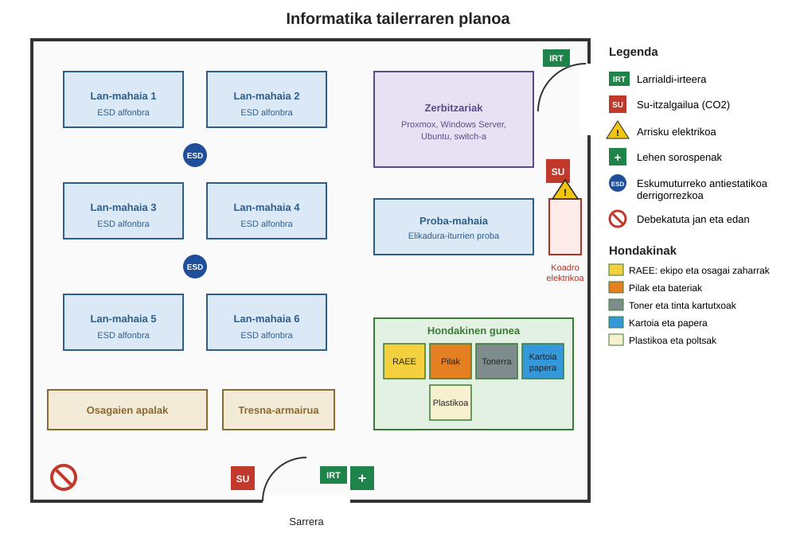

# 1. Erronka: Hardware dokumentazioa

T6 taldea. Erronkarako behar den hardwarea, haren osagaiak, tresnak, hondakinen kudeaketa eta tailerraren segurtasuna.

## 1. Aurrekostua

T6 taldea. Prezioak 2026ko urriaren 13an begiratu ditugu, Espainiako dendetan, eta BEZa barne dute.

### 1.1 Zer erosi behar den

Hamalau ekipo fisiko behar dira: Windows Server-entzako zerbitzari bat, Proxmox-entzako zerbitzari bat, Ubuntu-rentzako bi zerbitzari eta Windows 11 duten hamar bezero. Domeinuan 10 erabiltzaile daude, beraz bakoitzak bere ordenagailua du.

### 1.2 Hardwarea

| Ekipoa | Eredua | Kopurua | Prezioa | Guztira |
|---|---|---|---|---|
| Windows Server zerbitzaria | Dell PowerEdge T160, Xeon 6315P, 32 GB RAM, 2 TB | 1 | 1.974,25 € | 1.974,25 € |
| Proxmox zerbitzaria | Dell PowerEdge T160, Xeon 6315P, 32 GB RAM, 2 TB | 1 | 1.974,25 € | 1.974,25 € |
| Ubuntu zerbitzaria | Dell PowerEdge T160, Xeon 6315P, 32 GB RAM, 2 TB | 2 | 1.974,25 € | 3.948,50 € |
| Windows 11 bezeroa | Dell Pro QCM1250, Core i5-14500T, 16 GB RAM, 512 GB SSD | 10 | 849,00 € | 8.490,00 € |

Hardwarea guztira: 16.387,00 €

Lau zerbitzarietarako eredu bera aukeratu dugu. Begiratu ditugun zerbitzarien artean merkeena da, eta denak berdinak izanda ordezko piezak eta mantentze-lana berdinak dira lauretan. Dorre formatukoa da, enpresak ez duelako rack armairurik.

32 GB RAM nahikoa dira Windows Server-ek dituen roletarako (Active Directory, DNS, DHCP, fitxategiak eta inprimaketa) eta Proxmox-en makina birtual batzuk izateko.

Bezeroetarako ordenagailu txikiak aukeratu ditugu, bulegoko lanerako nahikoa direlako eta Windows 11 Pro instalatuta dakartelako.

### 1.3 Lizentziak

| Lizentzia | Kopurua | Prezioa | Guztira |
|---|---|---|---|
| Windows Server 2025 Standard, 16 nukleo | 1 | 1.359,63 € | 1.359,63 € |
| Windows Server 2025 erabiltzaile CALak, 5eko paketea | 2 | 276,59 € | 553,18 € |
| Windows 11 Pro | 10 | Ordenagailuarekin dator | 0,00 € |
| Proxmox VE | 1 | Doakoa | 0,00 € |
| Ubuntu Server | 2 | Doakoa | 0,00 € |

Lizentziak guztira: 1.912,81 €

Windows Server Standard edizioa aukeratu dugu, Datacenter edizioa garestiagoa delako eta makina birtual asko dituzten zerbitzarientzat delako. Lizentzia zerbitzariaren nukleoen arabera erosten da eta gutxienekoa 16 nukleo da, zerbitzariak gutxiago izan arren.

CALak beharrezkoak dira zerbitzarira konektatzen den erabiltzaile bakoitzeko. Domeinuan 10 erabiltzaile ditugu, beraz 5eko bi pakete behar dira. Erabiltzaile CALak hartu ditugu eta ez gailu CALak, erabiltzaile bat ordenagailu batean baino gehiagotan sar daitekeelako.

Windows 11k Pro edizioa izan behar du, Home edizioa ezin delako domeinuan sartu.

Proxmox VE eta Ubuntu Server software librea dira eta ez dute lizentziarik behar. Proxmox-ek ordainpeko harpidetza bat du, baina aukerakoa da eta ez dugu sartu.

### 1.4 Guztira

| Atala | Zenbatekoa |
|---|---|
| Hardwarea | 16.387,00 € |
| Lizentziak | 1.912,81 € |
| Guztira, BEZa barne | 18.299,81 € |

Zenbateko horretatik 15.123,81 € oinarria da eta 3.176,00 € BEZa (%21).

### 1.5 Aurrekostutik kanpo utzi duguna

Bezeroen pantailak, teklatuak eta saguak ez ditugu sartu. Sareko kableak eta switch-a ere ez.

Zerbitzari bakoitzak disko bakarra dakar. Disko hori hondatzen bada zerbitzari horretako dena galtzen da, beraz bigarren disko bat erostea eta biak ispiluan jartzea komeni da. Segurtasun-kopietarako kanpoko disko bat edo NAS bat ere beharko litzateke.

Proxmox-en Community harpidetzak 120 € inguru balio du urtean prozesadore bakoitzeko, eta eguneratze egonkorren biltegirako sarbidea ematen du.

### 1.6 Prezioen iturriak

- Zerbitzariak: https://www.pccomponentes.com/servidor-dell-poweredge-t160-intel-xeon-6315p-32gb-2tb-torre-no-os
- Bezeroak: https://www.pccomponentes.com/categorias/mini-pcs
- Windows Server 2025 Standard: https://www.senetic.es/product/DG7GMGF0PWHC-0003
- Erabiltzaile CALak: https://www.europeanpc.es/microsoft-windows-server-2025-cals-user-pack-5-unidades-370413

## 2. Osagaiak eta haien ezaugarriak

Aurrekostuan bi ekipo mota daude: zerbitzaria (Dell PowerEdge T160) eta bezeroa (Dell Pro Micro QCM1250). Atal honetan bakoitzaren osagaiak eta ezaugarriak jaso ditugu, fabrikatzailearen fitxa teknikoan oinarrituta.

### 2.1 Zerbitzaria: Dell PowerEdge T160

| Osagaia | Gure ekipoan | Ezaugarriak |
|---|---|---|
| Oinarrizko plaka | Dell-en plaka propioa | Socket bakarra (LGA1700), ECC DDR5 UDIMM memoriarentzako 4 zirrikitu, 128 GB gehienez, dual channel, UEFI firmwarea |
| PUZ | Intel Xeon 6315P | 4 nukleo, 2,8 GHz, 12 MB cache, LGA1700 socketa, Xeon 6 belaunaldia, ez du overclock-ik onartzen |
| RAM | 32 GB DDR5 ECC | DDR5 UDIMM motakoa, akatsak zuzentzen dituena (ECC), 4400 MT/s arte |
| Diskoa | 2 TB | 3,5 hazbeteko diskoa, SATA interfazea. Kablez konektatutako 4 disko arte onartzen ditu |
| Elikadura-iturria | 300 W | 80 PLUS Bronze ziurtagiria. 500 W-ko Platinum iturria ere aukera daiteke |
| Txartel grafikoa | Plakan txertatua | Matrox G200, iDRAC kudeaketa-txartelaren barruan. Monitore bat konektatzeko nahikoa da |
| Hedapen-txartelak | 2 PCIe zirrikitu | PCIe 4.0 x16 bat eta PCIe 4.0 x4 bat, sare-txartel edo disko-kontrolatzaile gehiago jartzeko |
| Txasisa | Dorrea | Dorre txikia, rack armairurik gabe bulegoan jartzeko |
| Disipadoreak eta haizegailuak | Disipadore pasiboa eta sistemaren haizegailuak | Txasiseko haizegailuek airea mugitzen dute disipadoretik |
| Irakurgailu optikoa | Ez du | Aukerakoa da. Guk ez dugu behar, instalazioak USB bidez egiten ditugulako |

### 2.2 Bezeroa: Dell Pro Micro QCM1250

| Osagaia | Gure ekipoan | Ezaugarriak |
|---|---|---|
| Oinarrizko plaka | Dell-en plaka propioa | Mikro formatua, DDR5 SO-DIMM memoriarentzako 2 zirrikitu, 64 GB gehienez, dual channel, UEFI firmwarea |
| PUZ | Intel Core i5-14500T | 14 nukleo (6 errendimendukoak eta 8 eraginkortasunekoak), 20 hari, 4,8 GHz arte, 24 MB cache, LGA1700 socketa, 14. belaunaldia, ez du overclock-ik onartzen |
| RAM | 16 GB DDR5 | SO-DIMM motakoa (eramangarrietakoa bezalakoa), 262 pin |
| Diskoa | 512 GB SSD | M.2 NVMe, PCIe 4.0 interfazea. SSDentzako bi M.2 zirrikitu ditu |
| Elikadura-iturria | Kanpoko egokigailua | 90 W-koa, ordenagailutik kanpo |
| Txartel grafikoa | PUZean txertatua | Intel UHD Graphics 770, RAM memoriaren zati bat erabiltzen du |
| Hedapen-txartelak | M.2 Wi-Fi txartela | Wi-Fi 6E eta Bluetooth 5.3. Ez du PCIe zirrikiturik |
| Txasisa | Mikro | Oso txikia, pantailaren atzean edo mahai azpian jar daiteke |
| Disipadoreak eta haizegailuak | Disipadorea eta haizegailu bat | Haizegailuak airea txasisaren atzealdetik ateratzen du |
| Irakurgailu optikoa | Ez du | Formatu honetan ez dago lekurik |

## 3. Osagaien funtzioa eta nola identifikatzen ditugun

| Osagaia | Funtzioa | Nola identifikatzen dugu |
|---|---|---|
| Oinarrizko plaka | Osagai guztiak elkarrekin konektatzen ditu eta haien artean datuak eta korrontea banatzen ditu | Plaka handiena da eta beste guztiak bertan konektatzen dira. Eredua plakan bertan serigrafiatuta dago |
| PUZ | Programen aginduak exekutatzen ditu | Socket-ean dago, disipadorearen azpian. Eredua gainazalean idatzita dago |
| RAM | Exekutatzen ari diren programen datuak gordetzen ditu, ordenagailua itzaltzean galtzen dira | Plakaren zirrikitu luzeetan dauden txartel meheak. Etiketan mota, tamaina, abiadura eta latentzia (CL) daude |
| Diskoa | Datuak eta sistema eragilea modu iraunkorrean gordetzen ditu | HDDa kutxa metaliko bat da SATA kablearekin. M.2 SSDa txartel txiki bat da, plakan zuzenean |
| Elikadura-iturria | Korronte alternoa osagaiek behar duten korronte zuzen bihurtzen du | Kable guztiak ateratzen diren kutxa. Etiketan potentzia eta ziurtagiria daude |
| Txartel grafikoa | Pantailan ikusten den irudia sortzen du | Txertatua bada, plakako bideo-irteera da. Bestela, PCIe zirrikitu bateko txartela |
| Hedapen-txartelak | Plakak ez dituen funtzioak gehitzen dituzte (sarea, Wi-Fi, diskoak) | PCIe edo M.2 zirrikitu batean konektatutako txartelak |
| Txasisa | Osagaiak babesten ditu eta airearen bidea zehazten du | Kanpoko kutxa da. Formatua tamainaren eta plakaren arabera ezagutzen da |
| Disipadoreak eta haizegailuak | PUZaren eta beste osagaien beroa kanporatzen dute | Hegal metalikoak PUZaren gainean eta txasiseko haizegailuak |
| Irakurgailu optikoa | CD eta DVD diskoak irakurtzen ditu | Txasisaren aurrealdeko erretilua |

Osagaiak bi modutan identifikatzen ditugu. Ordenagailua irekita, osagai bakoitza bere formagatik, konektoreengatik eta etiketagatik ezagutzen dugu. Ordenagailua piztuta, Windows-en msinfo32 eta Ataza-kudeatzailea erabiltzen ditugu, eta Linux-en lshw eta dmidecode komandoak. Dell zerbitzarian iDRAC web interfazeak osagai guztien zerrenda ematen du, ordenagailua ireki gabe.

## 4. Beharrezko tresnak

| Tresna | Zertarako |
|---|---|
| Phillips bihurkina (PH1 eta PH2) | Txasisa, diskoak eta plaka lotzen dituzten torlojuak kentzeko |
| Torx bihurkina (T15) | Dell zerbitzarietako disko-euskarri batzuetan Torx torlojuak daudelako |
| Pintzak | Toki estuetan erortzen diren torlojuak hartzeko eta jumper-ak mugitzeko |
| Eskumuturreko antiestatikoa | Gure gorputzeko elektrizitate estatikoak osagaiak ez hondatzeko |
| Alfonbra antiestatikoa | Osagaiak gainean uzteko, deskarga estatikorik gabe |
| Pasta termikoa eta isopropil alkohola | PUZaren disipadorea kentzen denean pasta zaharra garbitu eta berria jartzeko |
| Aire konprimitua | Haizegailuetako eta disipadoreetako hautsa kentzeko |
| Elikadura-iturrien probatzailea edo multimetroa | Iturriak tentsio zuzenak ematen dituen egiaztatzeko |
| Linterna | Txasisaren barruko etiketak eta konektoreak ikusteko |
| Brida eta etiketak | Kableak antolatzeko eta zein den bakoitza jakiteko |
| USB abiarazgarria | Sistema eragileak instalatzeko eta diagnostiko-tresnak exekutatzeko |

## 5. Hondakinak eta birziklatzea

Tailerrean bost hondakin mota bereizten ditugu, eta bakoitzak bere edukiontzia du hondakinen gunean:

| Hondakina | Adibideak | Nora doa |
|---|---|---|
| RAEE (gailu elektriko eta elektronikoak) | Ordenagailu zaharrak, plakak, iturriak, kableak | Gestore baimendu batera |
| Pilak eta bateriak | Plaketako CR2032 pilak, SAI-en bateriak | Pilen bilketa-sistemara |
| Toner eta tinta kartutxoak | Inprimagailuen kartutxo hutsak | Hornitzaileari itzultzen zaizkio |
| Kartoia eta papera | Osagaien kutxak, eskuliburuak | Edukiontzi urdinera |
| Plastikoa | Poltsa antiestatikoak, babesak | Edukiontzi horira |

RAEEak ezin dira zabor arruntera bota, metal astunak eta substantzia arriskutsuak dituztelako. Ikastetxetik ateratzeko, tailerreko edukiontzia betetzen denean ikastetxeko biltegira eramaten da, eta hortik gestore baimendu batek jasotzen du. Euskadin RAEEak kudeatzeko baimena duten enpresen artean daude Indumetal Recycling (RAEEak balorizatu eta berrerabiltzeko prestatzen ditu) eta Emaús Fundación Social (gailuak berrerabiltzeko prestatzen ditu). Fabrikatzaileek RAEEen bilketa sistema kolektiboen bidez ordaintzen dute, adibidez Ecolec eta ECOTIC.

Kopuru txikiak udalerriko garbigunera ere eraman daitezke.

Diskoak bota aurretik ezabatu egiten ditugu, edo fisikoki apurtzen ditugu, enpresaren datuak inork berreskura ez ditzan.

## 6. Tailerraren kokapena eta segurtasuna

Informatika tailerraren planoa egin dugu, elementu bakoitza non dagoen, hondakinen edukiontziak eta arrisku-seinaleak adierazita.

Elementuak honela kokatu ditugu:

- Lan-mahaiak tailerraren erdian daude, sarreratik gertu, eta bakoitzak alfonbra antiestatikoa du. Mahaien artean ESD seinalea dago, eskumuturrekoa derrigorrezkoa dela gogorarazteko.
- Zerbitzariak gune bereizi batean daude, lan-mahaietatik urrun, inork ez ditzan nahi gabe ukitu eta zarata gutxiago egon dadin.
- Proba-mahaia koadro elektrikoaren ondoan dago, elikadura-iturriak probatzeko korronte-hartune gehien hor daudelako.
- Koadro elektrikoak arrisku elektrikoaren seinalea du, eta ondoan CO2zko su-itzalgailua. CO2 erabiltzen dugu urak edo hautsak ekipo elektrikoak hondatzen dituztelako.
- Hondakinen gunea sarreratik gertu dago, edukiontziak ateratzeko tailer osoa zeharkatu behar ez izateko.
- Bi larrialdi-irteera daude, bata sarreran eta bestea zerbitzarien ondoan, eta biak seinaleztatuta daude. Sarreran bigarren su-itzalgailua eta lehen sorospenetako kutxa daude.
- Tailerrean debekatuta dago jatea eta edatea, likido batek ekipo bat hondatu edo zirkuitulaburra eragin dezakeelako.
