# 1. Erronka: SB dokumentazioa

T6 taldea. Sistema banatuak.

## 1. Sistema banatuaren beharra

Enpresak hainbat zerbitzu behar ditu: intzidentziak kudeatzeko GLPI eta sarea babesteko suebakia, besteak beste. Zerbitzu bakoitzarentzat ordenagailu fisiko bat jartzea garestia da, leku asko hartzen du eta makina gehienak ia lanik gabe egoten dira.

Horregatik zerbitzuak birtualizatzea erabaki dugu. Zerbitzari fisiko bakar batean hainbat makina birtual eta edukiontzi jarri ditugu, bakoitza bere zerbitzuarekin. Zerbitzu batek huts egiten badu besteek lanean jarraitzen dute, eta makina birtual bat beste zerbitzari batera eraman daiteke berriro instalatu gabe.

Arazo bat geratzen da: zerbitzari fisikoa hondatzen bada, zerbitzu guztiak batera erortzen dira. Hori konpontzeko erabilgarritasun handiko soluzioa proposatzen dugu 2. atalean.

## 2. Erabilgarritasun handiko soluzioa

Gaur egun nodo bakarra dugu. Proxmox-en HA panela aktibo dago eta quorum-a ondo dago, baina ez dago baliabiderik HAn sartuta, nodo bakarrarekin ezin delako makina bat beste nodo batera pasatu.

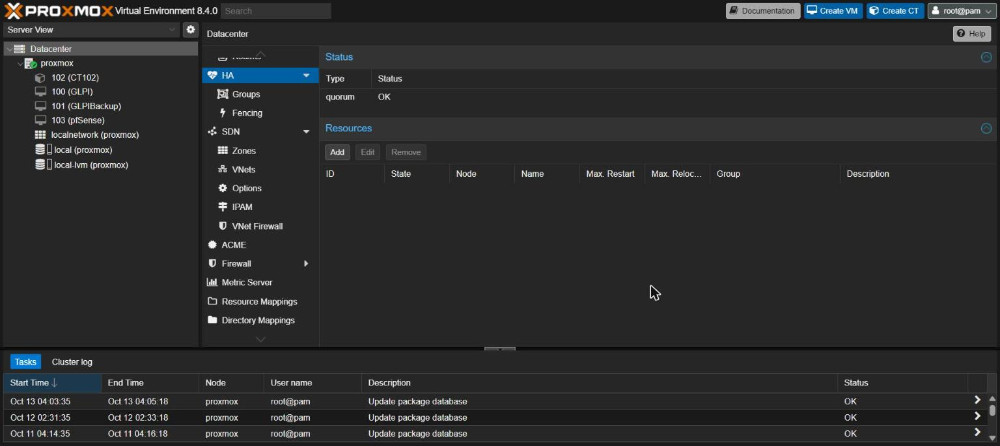

Oraingoz egin duguna hau da: GLPI zerbitzuarentzat bi makina birtual sortu ditugu, GLPI eta GLPIBackup, ezaugarri berdinekin. Lehenengoak huts egiten badu bigarrena dago.

Proposatzen dugun soluzioa hiru nodoko kluster bat da. Hiru behar dira eta ez bi, quorum-a mantentzeko nodoen erdia baino gehiago bizirik egon behar delako: hiru nodorekin bat eror daiteke eta beste biek gehiengoa dute. Makina birtualen diskoak nodo guztiek ikusten duten biltegi partekatu batean egongo lirateke (Ceph edo NFS), eta horrela nodo bat erortzen denean Proxmox-ek makina birtualak beste nodo batean pizten ditu automatikoki.

## 3. Birtualizazio-tresna

Proxmox VE aukeratu dugu. Software librea da eta ez du lizentziarik behar. Makina birtualak (KVM) eta edukiontziak (LXC) tresna beretik kudeatzen ditu, eta guk biak behar ditugu. Web interfaze batetik administratzen da, eta klusterra eta HA barne dakartza, beste programarik instalatu gabe.

### 3.1 Nodoaren ezaugarriak

| Ezaugarria | Balioa |
|---|---|
| Izena | proxmox |
| Bertsioa | Proxmox VE 8.4.0 |
| Kernela | Linux 6.8.12-9-pve |
| Prozesadorea | 2 x Intel Xeon E5-2630, 2,30 GHz, 24 hari guztira |
| RAM memoria | 47 GB |
| Sistemaren diskoa | 94 GB |
| Abioa | Legacy BIOS |
| IP helbidea | 192.168.71.185/24 |
| Atebidea | 192.168.71.254 |
| Web interfazea | https://192.168.71.185:8006 |

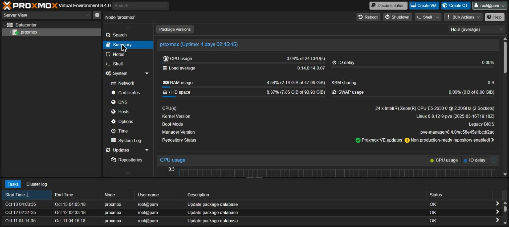

Eguneratzeetarako harpidetzarik gabeko biltegia erabiltzen dugu, harpidetza ordainpekoa delako.

### 3.2 Sareak

Zerbitzariak lau sare-txartel ditu (eno1etik eno4ra) eta eno4 bakarrik dago konektatuta. Bi zubi sortu ditugu:

| Zubia | Portua | IP helbidea | Zertarako |
|---|---|---|---|
| vmbr0 | eno4 | 192.168.71.185/24 | Ikastetxeko sarera irteteko. Nodoaren IPa hemen dago. |
| vmbr1 | Portu fisikorik gabe | IPrik gabe | Barneko LANa. Makina birtualen artean bakarrik dago. |

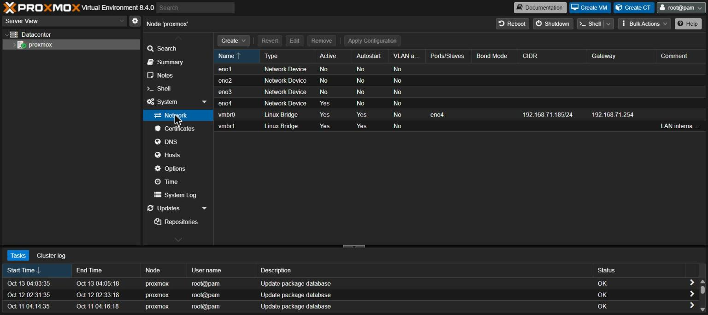

vmbr1 zubiak ez du portu fisikorik, barneko sarea kanpotik isolatuta egotea nahi dugulako. Sare horretatik kanpora irteteko bide bakarra pfSense makina da.

### 3.3 Biltegia

Bi biltegi daude. local biltegian ISO irudiak gordetzen ditugu, pfSense instalatzeko ISOa adibidez. local-lvm biltegia LVM-Thin motakoa da, 1,64 TB ditu, eta makina birtualen eta edukiontziaren diskoak hor daude. LVM-Thin erabiltzean diskoek benetan betetako lekua bakarrik hartzen dute: 120 GB esleitu ditugu guztira eta 51 GB daude erabilita.

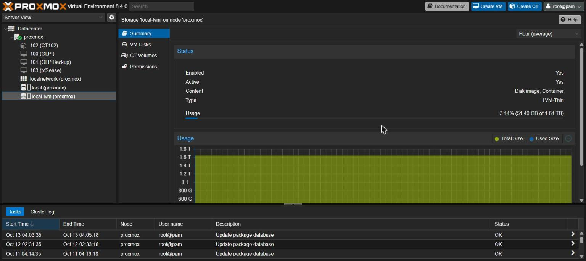

## 4. Birtualizatutako zerbitzuak

Hiru makina birtual eta edukiontzi bat ditugu.

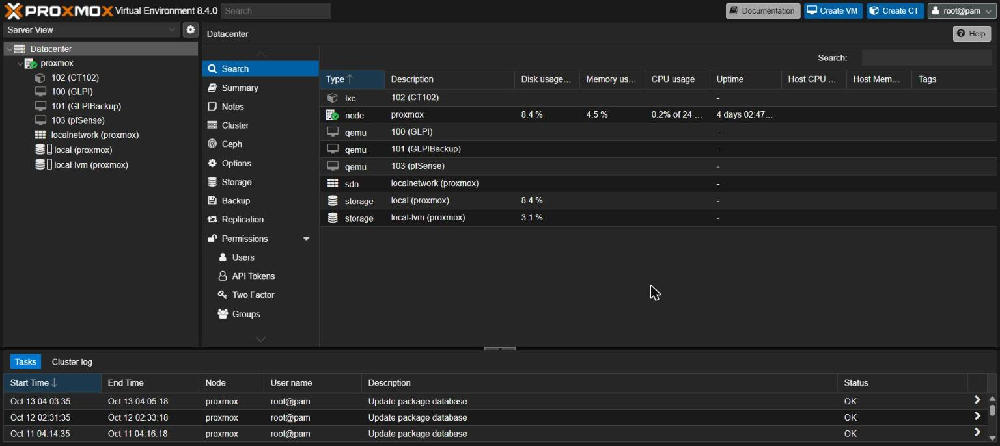

| ID | Izena | Mota | CPU | RAM | Diskoa | Sarea |
|---|---|---|---|---|---|---|
| 100 | GLPI | Makina birtuala | 2 nukleo | 4 GB | 40 GB | vmbr0, 192.168.71.186 |
| 101 | GLPIBackup | Makina birtuala | 2 nukleo | 4 GB | 40 GB | vmbr0 |
| 102 | CT102 | Edukiontzia | 1 nukleo | 512 MB | 8 GB | vmbr0 |
| 103 | pfSense | Makina birtuala | 2 nukleo | 4 GB | 32 GB | vmbr0 eta vmbr1 |

### 4.1 GLPI makina birtuala

GLPI zerbitzua makina birtual batean jarri dugu, Linux sistema eragilearekin. 192.168.71.186 IP helbidea du, nodoaren sare berean, ikastetxeko saretik zuzenean ireki ahal izateko. Makina birtuala aukeratu dugu eta ez edukiontzia, GLPIk web zerbitzaria eta datu-basea behar dituelako eta sistema oso bat izatea erosoagoa delako.

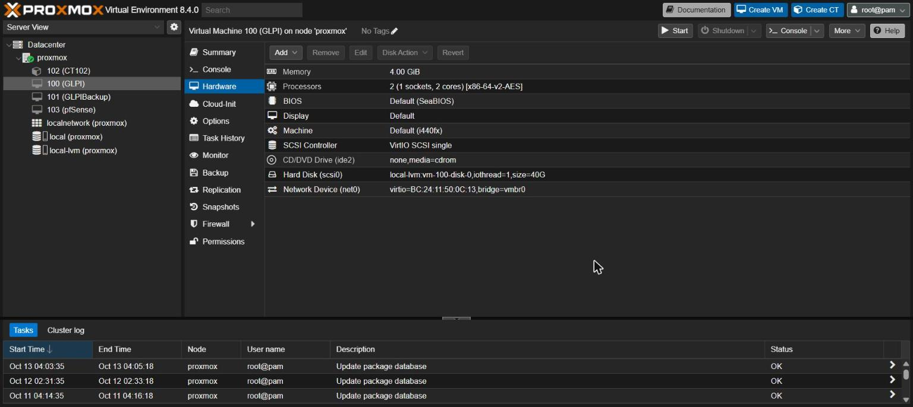

Makina piztuta dagoenean GLPIren web orria http://192.168.71.186 helbidean irekitzen da.

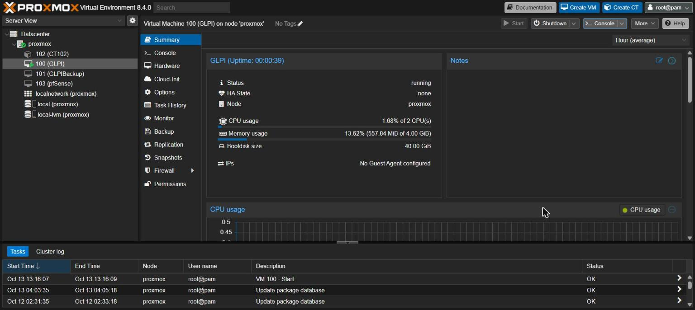

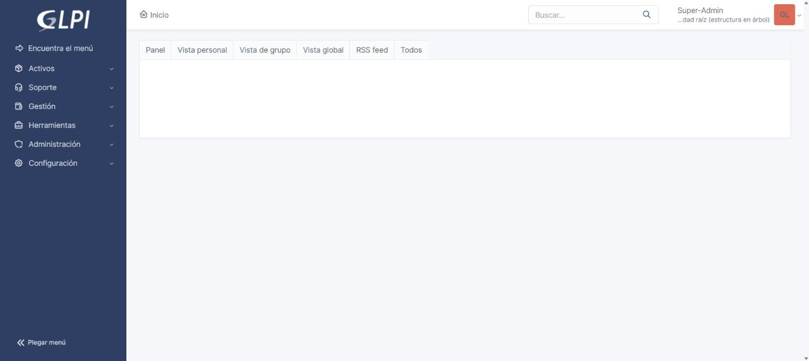

GLPIBackup makinak ezaugarri berak ditu.

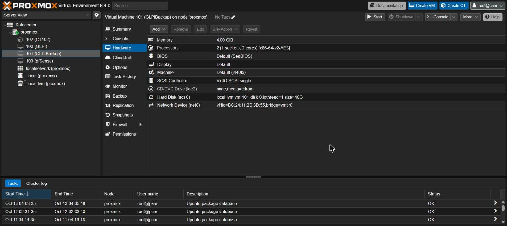

### 4.2 pfSense makina birtuala

pfSense suebakia da. Bi sare-txartel ditu: net0 vmbr0 zubian dago eta kanpoko aldea da (WAN), eta net1 vmbr1 zubian dago eta barneko aldea da (LAN). Barneko sareko makinen trafiko guztia hemendik pasatzen da.

Makina birtuala izan behar du, pfSense FreeBSD gainean dabilelako eta LXC edukiontziek Linux bakarrik onartzen dutelako. Prozesadore mota host jarri diogu, zifratzeko AES-NI aginduak erabili ahal izateko.

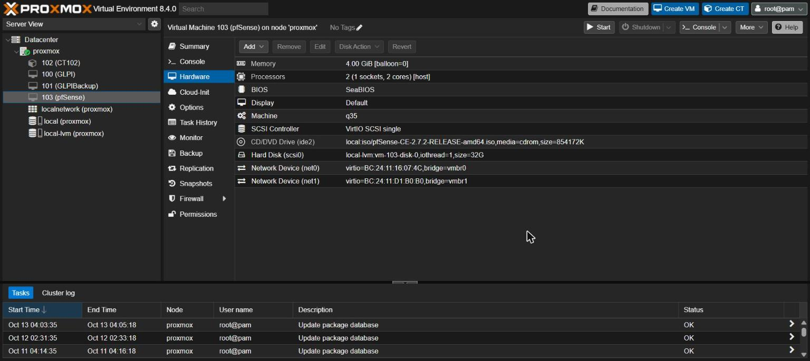

### 4.3 CT102 edukiontzia

Erronkak edukiontzi bat sortzea eskatzen zuen, eta horregatik sortu dugu CT102. Ez diogu zerbitzurik jarri, irakasleak esan digulako sortzea nahikoa dela.

Edukiontzia Debian da eta pribilegiorik gabekoa. Pribilegiorik gabe sortu dugu seguruagoa delako: edukiontziaren barruko root erabiltzaileak ez du root baimenik nodoan.

Baliabide gutxi eman dizkiogu, 512 MB RAM eta nukleo bat. Edukiontziak nodoaren kernela erabiltzen du eta ez du sistema eragile oso bat abiarazi behar, beraz horrekin nahikoa du.

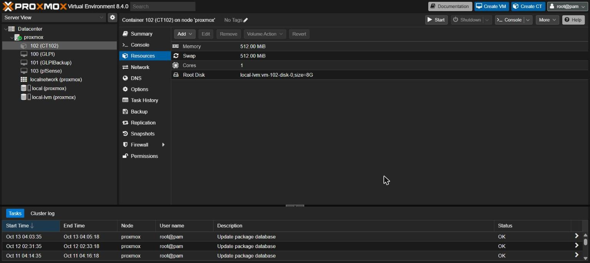

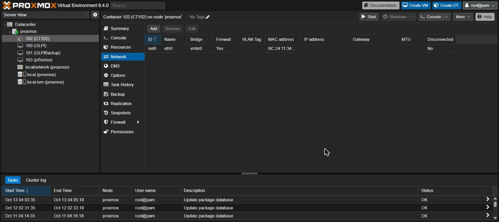
