# 1. Erronka: SEA dokumentazioa

T6 taldea. core.lan domeinua.

## 1. Domeinua eta zerbitzaria

### 1.1 Domeinua

Baso berri bat sortu dugu domeinu bakarrarekin: core.lan. NetBIOS izena CORE da eta maila funtzionala Windows Server 2016. Ez dugu azpidomeinurik ez beste zuhaitzik sortu, enpresa txikia delako eta egoitza bakarra duelako; domeinu batekin dena leku beretik administratzen da.

.lan amaiera erabili dugu barneko domeinua delako, eta horrela ez dator bat Interneteko benetako domeinu batekin.

### 1.2 Zerbitzaria eta rolak

Domeinu-kontrolatzailea WS_T6 da. 192.168.10.1 IP finkoa jarri diogu, bezeroek DNS gisa erabiltzen dutelako eta helbide hori ezin delako aldatu. Bere DNSak bere buruari begiratzen dio (127.0.0.1) eta atebidea pfSense da, 192.168.10.254.

Instalatuta dituen rolak hauek dira:

| Rola | Zergatik instalatu dugun |
|---|---|
| AD DS | Direktorioa da. Erabiltzaileak zerbitzarian egiaztatzen dira, ez ekipo bakoitzean. |
| DNS | core.lan eta core.eus zonak. Xehetasunak SZI dokumentazioan. |
| DHCP | Bezeroei IPa, atebidea eta DNSa banatzeko. Xehetasunak SZI dokumentazioan. |
| Fitxategi-zerbitzaria | LANGILEAK karpeta partekaturako; hor daude sailen karpetak eta karpeta pertsonalak. |
| Inprimaketa-zerbitzaria | Inprimagailuak zerbitzaritik partekatzeko. |

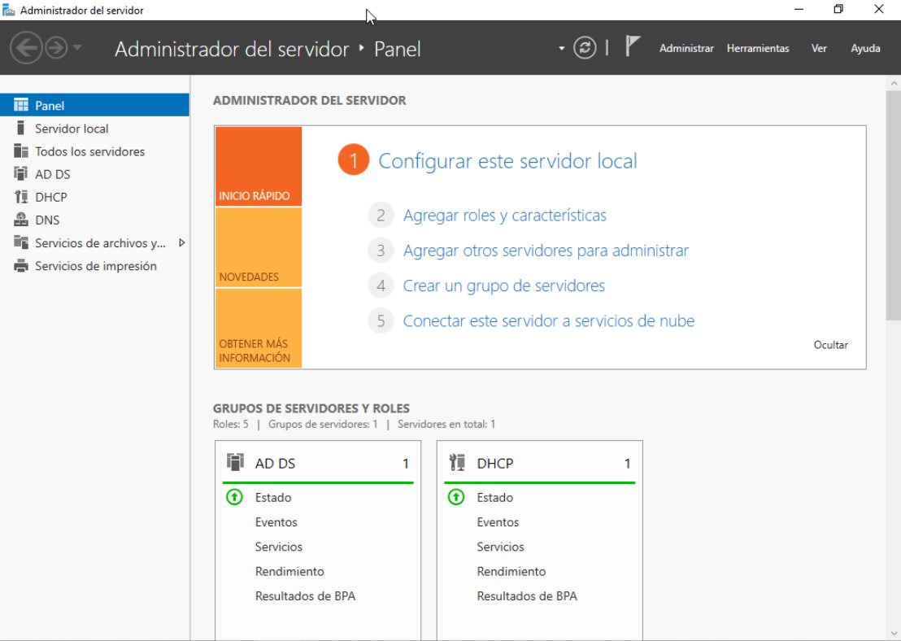

### 1.3 Ekipoak

| Ekipoa | Funtzioa | IPa | Administrari kontua |
|---|---|---|---|
| WS_T6 | Domeinu-kontrolatzailea | 192.168.10.1 | CORE\Administrador |
| WIN11BEZ1 | Windows 11 bezeroa | 192.168.10.40 (DHCP erreserba) | |
| WIN11BEZ2 | Windows 11 bezeroa | 192.168.10.102 (finkoa) | |
| pfSense | Bideratzailea eta suebakia | 192.168.10.254 | |

## 2. Antolakuntza-unitateak, erabiltzaileak eta taldeak

### 2.1 Antolakuntza-unitateak

Core izeneko OU bat sortu dugu, eta haren barruan bat sail bakoitzeko: IT, Finantzak, Giza Baliabideak eta Erosketak. Taldeak izeneko OU bat ere badago, talde guztiekin.

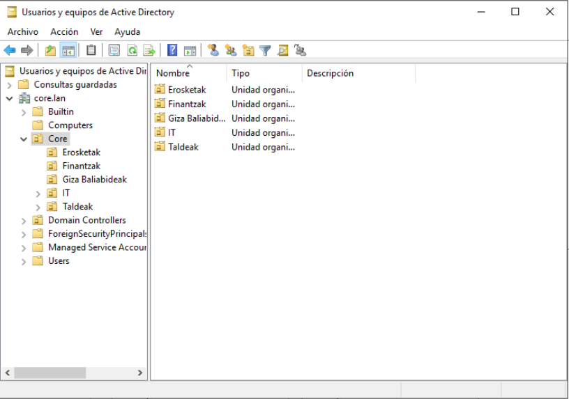

Core OUa enpresarena Active Directoryk dakartzan edukiontzietatik bereizteko dago, eta denentzako gidalerroak hor behin bakarrik estekatzen direlako. Sailen OUak daude sail bakoitzak gidalerro desberdinak behar ditzakeelako. Taldeak aparte jarri ditugu Taldeak OUan, erabiltzaileekin nahastuta ez edukitzeko.

### 2.2 Erabiltzaileak eta taldeak

Erabiltzaile bakoitza bere saileko OUan dago eta izen bereko taldean. Sareko unitatea taldearen arabera doa; norbait berria sartzen denean nahikoa da taldean sartzea.

Arduradunak taldea arduradunentzat da. Oraingoz Urtzi bakarrik dago.

| Erabiltzailea | Kontua | OUa | Taldeak |
|---|---|---|---|
| Oier | obravo | IT | IT |
| Peru | pmalatsetxebarria | IT | IT |
| Lierni | lgarcia | IT | IT |
| Urtzi | ubarrero | IT | IT, Arduradunak |
| Joseba Lopez | jlopez | Finantzak | Finantzak |
| Aritz Arrue | | Finantzak | Finantzak |
| Luis Tellabide | ltellabide | Giza Baliabideak | Giza Baliabideak |
| Estibaliz Zendoia | | Giza Baliabideak | Giza Baliabideak |
| Iker Herran | iherran | Erosketak | Erosketak |
| Jon Galarza | jgalarza | Erosketak | Erosketak |

Kontuek izenaren lehen letra eta abizena dituzte.

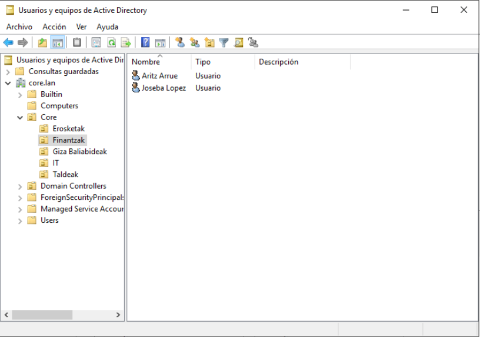

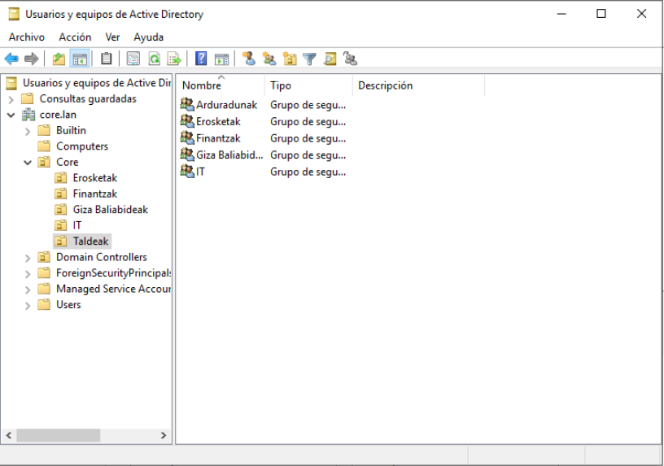

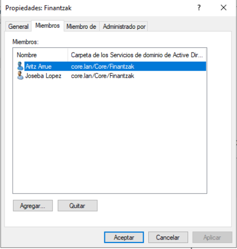

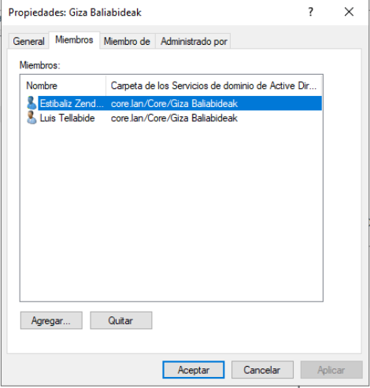

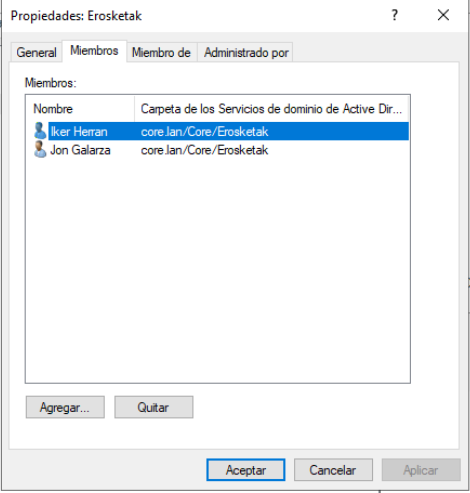

## 3. Bezeroak

Bi Windows 11 sartu ditugu domeinuan: WIN11BEZ1 eta WIN11BEZ2. WIN11BEZ1 ekipoak DHCP bidez hartzen du IPa (erreserba batekin, 192.168.10.40) eta WIN11BEZ2 ekipoak IP finkoa du, 192.168.10.102. Biak zerbitzariaren tarte berean daude eta DNS zerbitzari gisa WS_T6 dute.

WIN11BEZ2 ekipoan egiaztatu dugu: Jon Galarza domeinuko erabiltzailearekin (core\jgalarza) saioa hasita, ekipoak 192.168.10.102 IPa, 192.168.10.254 atebidea, 192.168.10.1 DNS zerbitzaria eta core.lan DNS atzizkia ditu.

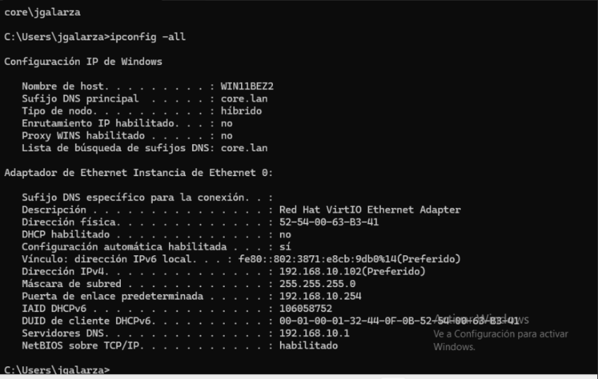

WIN11BEZ1 ekipoaren kontua IT OUra eraman dugu. WIN11BEZ2 ekipoarena Computers edukiontzian dago oraindik; ekipo bat domeinuan sartzean hor agertzen da.

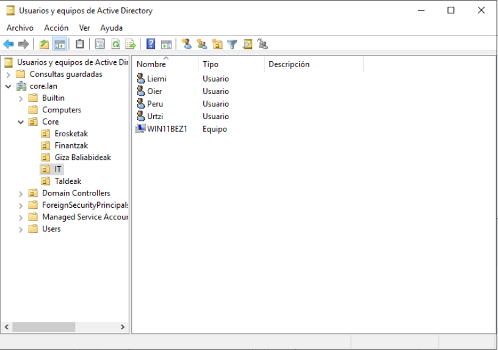

## 4. GPO-ak

Bost GPO sortu ditugu. Denak erabiltzailearen konfiguraziokoak dira, aldatzen dena saioa nork hasten duen araberakoa delako eta ez ekipoaren araberakoa.

Bezeroan gpresult komandoarekin egiaztatu dugu GPOak aplikatzen direla. Jon Galarzari lau GPO aplikatzen zaizkio (Pantailako atzeko planoa, Mapeatu, MapeatuPertsonala eta IMP_Finantzak) eta Erosketak taldean dago.

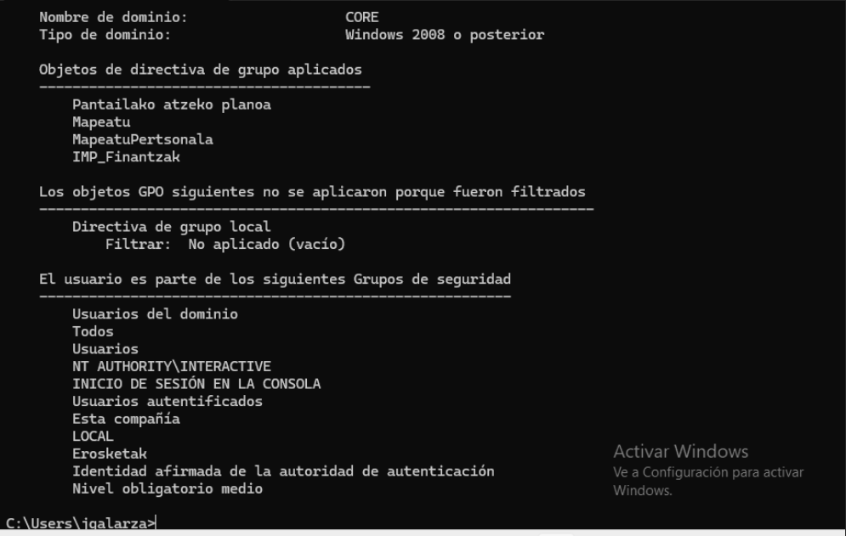

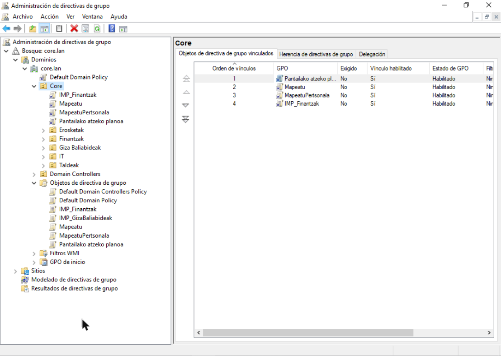

### 4.1 Pantailako atzeko planoa

Erabiltzaile guztientzako gidalerroa da eta Core OUari estekatuta dago. Bi arau ditu Administrazio-txantiloiak, Active Desktop atalean. Batek Active Desktop gaitzen du eta besteak \\\\Ws_t6\langileak\GPO\AtzealdeaGPO.jpeg irudia jartzen du atzeko plano gisa, Bete estiloarekin.

Ekipo guztiek enpresaren atzeko planoa izateko egin dugu, erabiltzaileak aldatu ezin duena. Active Desktop araua dago JPEG irudi bat erabiltzea horrek uzten duelako. Irudia zerbitzariko karpeta partekatu batean dago, bezero guztiak bertara irits daitezen.

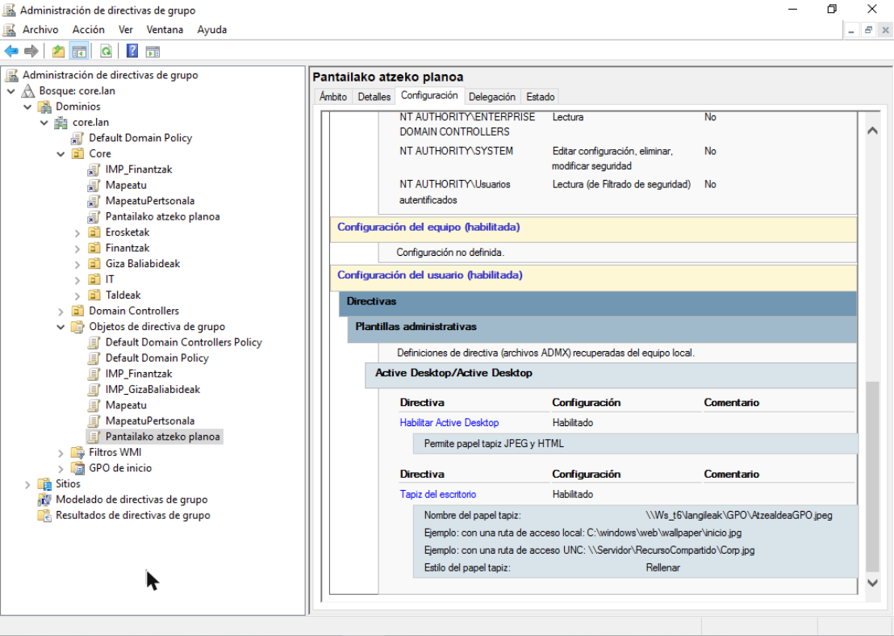

### 4.2 Mapeatu

Talde konkretuentzako gidalerroa da. P: unitatea saileko karpetara konektatzen du, \\\\Ws_t6\langileak\Departamentuak barruan. Sarrera bat du sail bakoitzeko, eta sarrera bakoitzak elementu-mailako iragazki bat du segurtasun-taldearekin. Finantzak taldeko erabiltzaile batek Finantzak karpeta du P: unitatean, eta Erosketak taldeko batek Erosketak karpeta.

Core OUari estekatuta dago. GPO bakarra erabili dugu taldekako iragazkiekin, OU bakoitzean GPO bat jarri beharrean, horrela gidalerro bakarra dagoelako mantentzeko; erabiltzaile bat sailez aldatzen bada, taldez aldatzea nahikoa da.

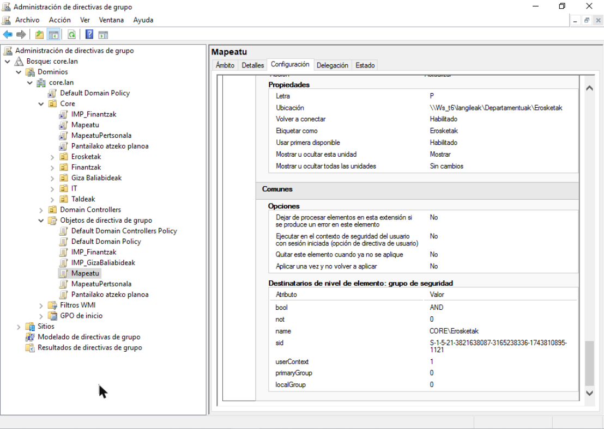

### 4.3 MapeatuPertsonala

Erabiltzaile bakoitzaren karpeta pertsonala sortzen du \\\\Ws_t6\langileak\Pertsonalak karpetan, bere kontuaren izenarekin. %username% aldagaia erabili dugu karpetak banan-banan ez sortzeko. Erabiltzailearen beraren baimenekin exekutatzen da, karpeta bere izenean gera dadin.

Bezeroan bi unitateak konektatuta daude: P: Erosketak saileko karpetara eta U: Jon Galarzaren karpeta pertsonalera.

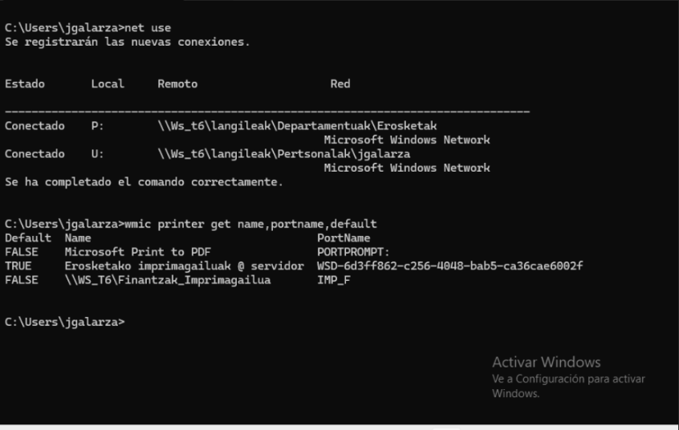

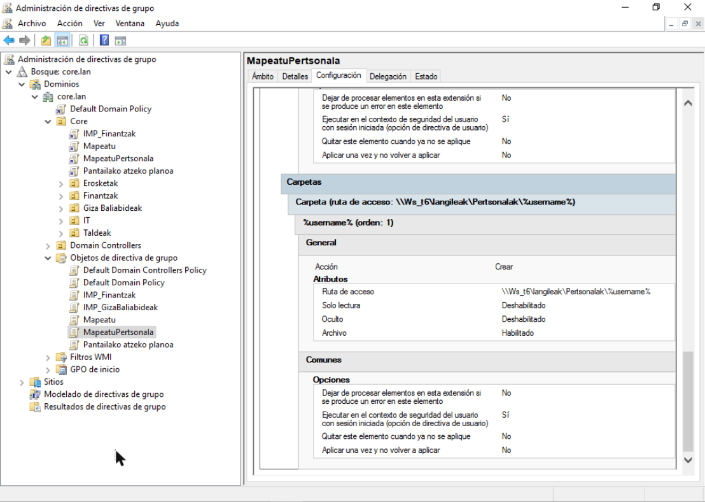

### 4.4 IMP_Finantzak eta IMP_GizaBaliabideak

Saileko inprimagailu partekatua instalatzen dute. IMP_Finantzak gidalerroak \\\\WS_T6\Finantzak_Imprimagailua konektatzen du eta Core OUari estekatuta dago. IMP_GizaBaliabideak gidalerroak \\\\WS_T6\GizaBaliabideak_Imprimagailua konektatzen du eta oraindik ez dago estekatuta.

GPO bidez egin ditugu, erabiltzaileak saioa hastean inprimagailua izan dezan ezer instalatu gabe.

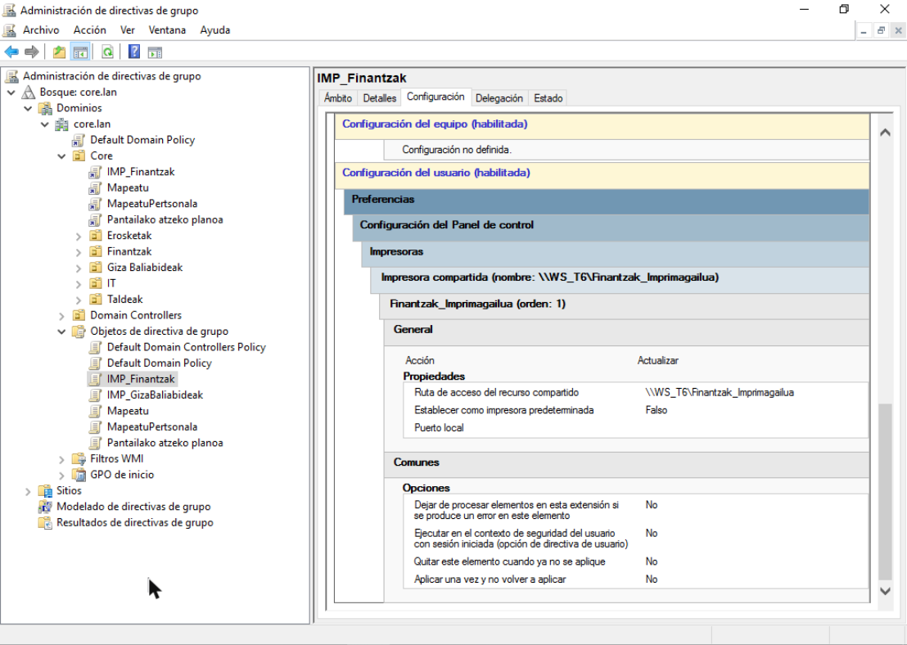

## 5. Inprimaketa

### 5.1 Inprimaketa-sistemaren funtzionamendua

Inprimagailuak WS_T6 zerbitzarian instalatuta eta partekatuta daude. Bezeroek ez dute inprimagailua beren ekipoan instalatzen: zerbitzariko inprimagailu partekatura konektatzen dira eta kontrolatzailea zerbitzaritik jaisten dute. Bezero batek inprimatzen duenean, lana zerbitzariko ilarara doa (Spooler zerbitzua) eta zerbitzariak bidaltzen dio inprimagailuari. Horrela kontrolatzaileak, ilara eta baimenak leku bakarrean kudeatzen dira.

Linux-en sistema bera CUPS bidez egiten da: CUPS-ek inprimagailuak partekatzen ditu sarean eta Windows bezeroek WSD bidez aurkitzen dituzte.

### 5.2 Inprimagailuak

Bi inprimagailu instalatu ditugu WS_T6 zerbitzarian, bat finantzetarako eta bestea giza baliabideetarako, sail horiek inprimatzen dituzten dokumentuak ez direlako besteenekin nahastu behar.

| Inprimagailua | Saila | Portua | Kontrolatzailea |
|---|---|---|---|
| Finantzak_Imprimagailua | Finantzak | IMP_F (lokala) | Generic / Text Only |
| GizaBaliabideak_Imprimagailua | Giza Baliabideak | IMP_GB (lokala) | Generic / Text Only |

Portu lokalak eta kontrolatzaile generikoa erabili ditugu, ingurune birtualean ez dagoelako inprimagailu fisikorik. Biak partekatuta daude eta direktorioan argitaratuta, bezeroetatik bilatu ahal izateko.

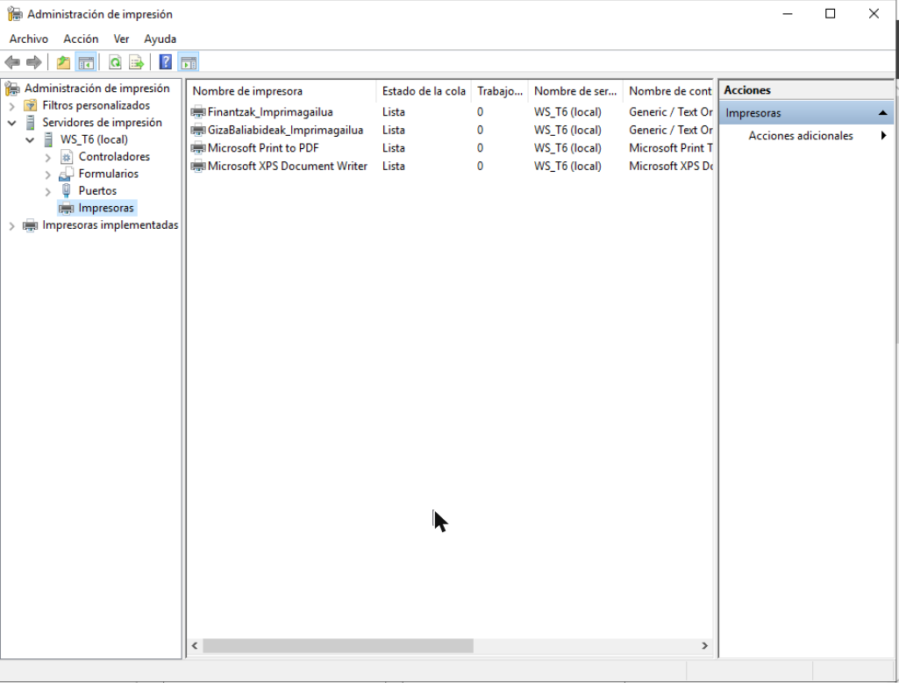

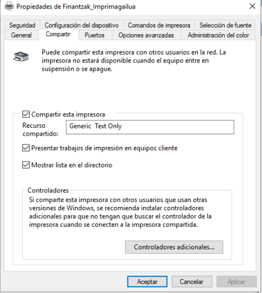

### 5.3 Baimenak

Bi inprimagailuek berezko baimena dute oraindik, eta horrekin Todos taldeak inprimatzen du. Dagozkien baimenak hauek dira: inprimatu, saileko taldeak; dokumentuak administratu, Arduradunak taldeak; inprimagailua administratu, IT taldeak eta administratzaileek.

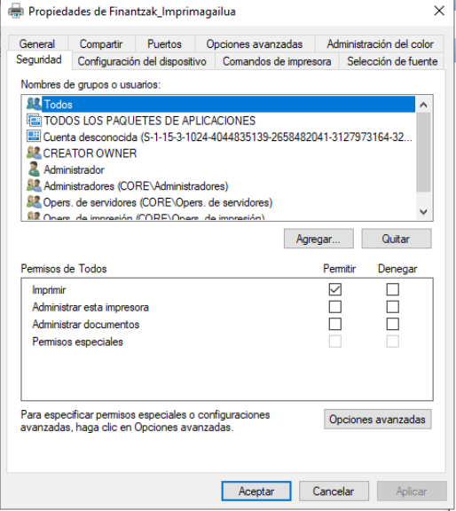

### 5.4 Portuak eta protokoloak

| Protokoloa | Portua | Non erabiltzen den |
|---|---|---|
| SMB | TCP 445 | Windows-eko inprimagailu partekatuak. Bezeroek hori erabiltzen dute \\\\WS_T6 zerbitzarira konektatzeko. |
| RPC | TCP 135 eta portu altu bat | Windows-eko inprimaketa-ilara |
| IPP | TCP 631 | CUPS Linuxen |
| LPD | TCP 515 | Windows-eko LPD zerbitzua eta cups-lpd Linuxen |
| RAW | TCP 9100 | Sareko inprimagailuak |
| mDNS | UDP 5353 | CUPSeko inprimagailuen iragarpena sarean |

### 5.5 Probak bezerotik

WIN11BEZ2 bezeroan bi inprimagailu daude: zerbitzariko Finantzak_Imprimagailua (IMP_Finantzak GPOak instalatua) eta Erosketako imprimagailuak, servidor izeneko Linux makinako CUPS-ek WSD bidez partekatua.

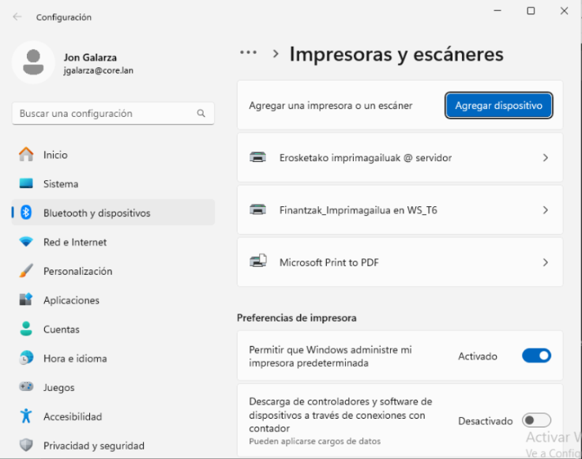

Bi inprimagailuetan proba-orria inprimatu dugu:

| Inprimagailua | Zerbitzaria | Emaitza |
|---|---|---|
| Erosketako imprimagailuak | Linux (CUPS) | Lana bidali da eta ilara hutsik geratu da |
| Finantzak_Imprimagailua | WS_T6 (Windows) | Errorea: inprimagailuak ez du orria inprimatu |

Finantzak_Imprimagailua inprimagailuak errorea ematen du, zerbitzarian IMP_F portu lokal batera konektatuta dagoelako eta portu horren atzean ez dagoelako gailurik. Konpontzeko portua aldatu behar da zerbitzarian.

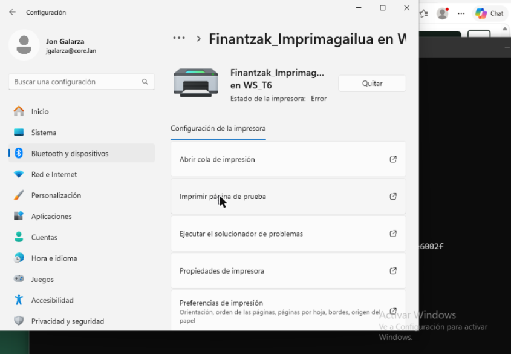

## 6. Prozesuak eta zerbitzuak

### 6.1 Active Directoryren zerbitzuak

Active Directory hainbat Windows zerbitzuren gainean dabil. Zerbitzuak kontsolan (services.msc) kudeatzen dira: hautatutako zerbitzua Detener, Iniciar edo Reiniciar estekekin geldiarazi, abiarazi edo berrabiarazten da, eta Estado zutabean egoera ikusten da. Services de dominio de Active Directory zerbitzua martxan dago eta Automático abioa du, zerbitzaria piztean bakarrik abiarazteko.

| Zerbitzua | Izena | Funtzioa |
|---|---|---|
| Servicios de dominio de Active Directory | NTDS | Direktorioaren datu-basea |
| Net Logon | Netlogon | Domeinuko saio-hasierak |
| Servidor DNS | DNS | Izenen ebazpena |
| Servidor DHCP | DHCPServer | IPen banaketa |
| Replicación DFS | DFSR | SYSVOL karpetaren erreplikazioa (GPOak) |
| Servicios web de Active Directory | ADWS | Active Directoryko PowerShell modulua |

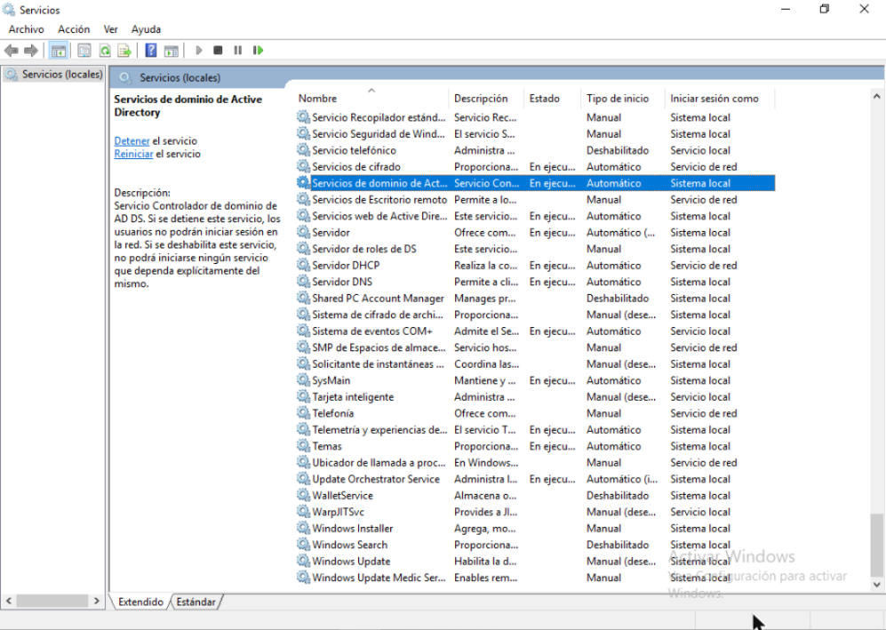

NTDS geldiaraziz gero, domeinuko erabiltzaileek ezin dute saioa hasi eta menpeko zerbitzuak ere gelditzen dira (KDC, DNS eta DFSR). Horregatik, zerbitzaria lanean dagoela ez da geldiarazi behar; mantentze-lanetarako bakarrik.

### 6.2 Prozesuak

Prozesuak Administrador de tareas tresnarekin kontrolatzen ditugu:

- **Procesos** fitxan aplikazioak eta atzeko planoko prozesuak ikusten dira, bakoitzak erabiltzen duen CPU eta memoriarekin.
- **Detalles** fitxan prozesu bakoitzaren PIDa, egoera eta erabiltzailea agertzen dira. Hemendik prozesu bat amaitu edo bere lehentasuna alda daiteke (eskuineko botoia).
- **Servicios** fitxan zerbitzu bakoitza zein prozesutan dagoen ikusten da PIDaren bidez.

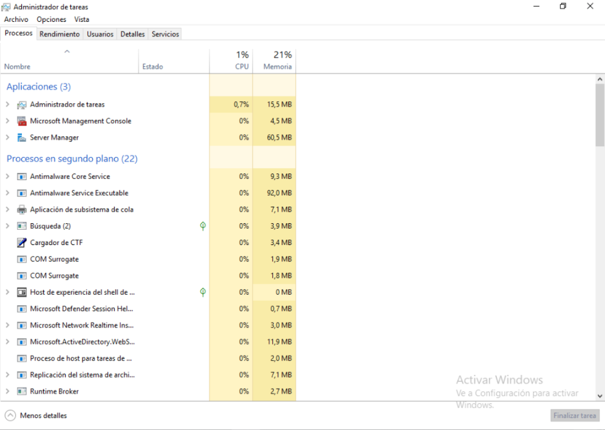

Active Directory lsass.exe prozesuaren barruan dabil. Detalles fitxan lsass.exe prozesuak 668 PIDa du, eta Servicios fitxan NTDS eta Netlogon zerbitzuek PID bera dute. Beraz, lsass.exe ez da inoiz amaitu behar: amaituz gero, zerbitzaria berrabiarazten da.

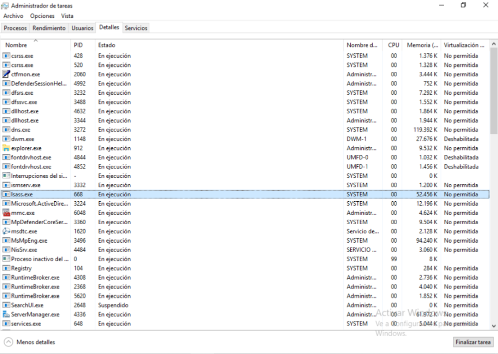

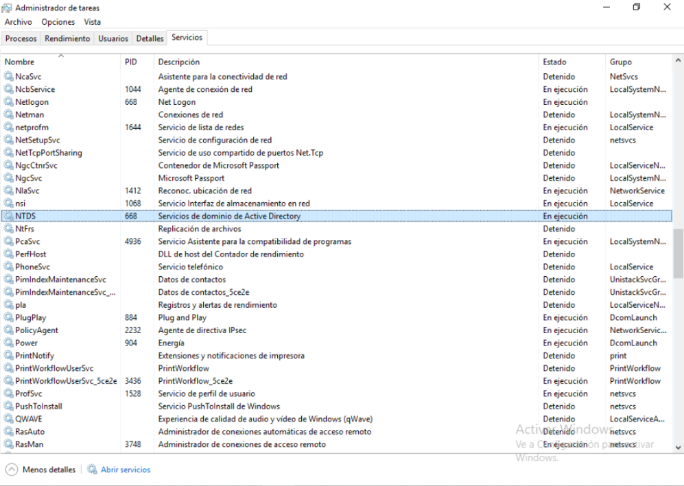

Rendimiento fitxan zerbitzariaren baliabideak ikusten dira: 4 prozesadore birtual eta 8 GB RAM ditu, eta lanean ari denean CPUaren %1 eta memoriaren %21 erabiltzen ditu. Hemendik Monitor de recursos ere ireki daiteke, prozesu bakoitzaren disko eta sare erabilera ikusteko.

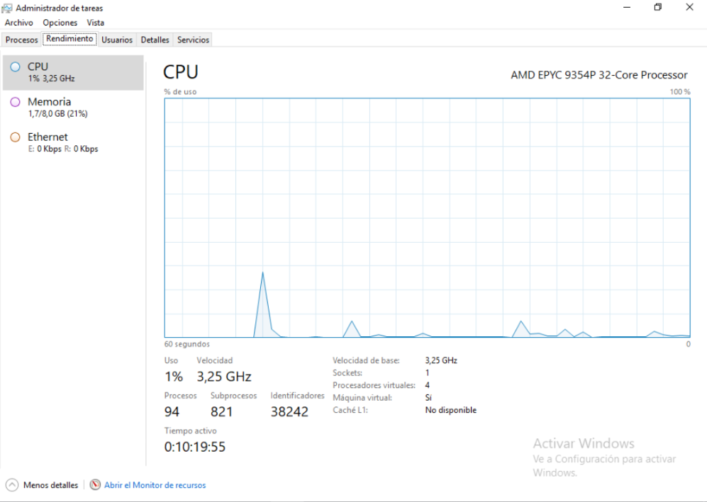
