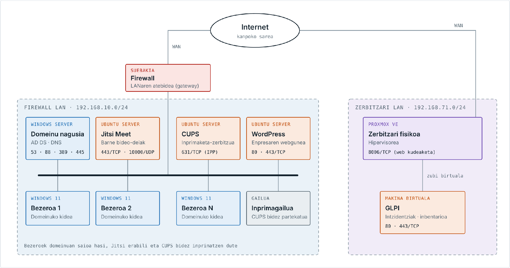
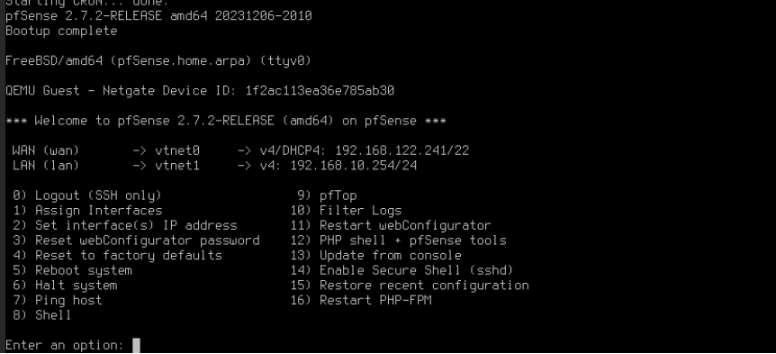

# 1. Erronka: SEG dokumentazioa

T6 taldea. Core enpresaren sistema informatikoaren segurtasuna.

Dokumentu honek Core-ren azpiegitura nola babesten dugun azaltzen du: kontingentzia-plana, pasahitzen eta sarbide fisikoaren politikak, sarearen diseinua, suebakia, urruneko sarbidea eta erasoen detekzioa. Atal bakoitzean bereizten dugu zer dagoen ezarrita eta zer proposatzen dugun.

## 1. Kontingentzia-plana

Kontingentzia-plan osoa dokumentu bereizi batean dago (Core_Kontingentzia_Plana, 1.0 bertsioa, 2026/10/08). Hemen bere egitura eta ondorio nagusiak laburtzen ditugu.

### 1.1 Enpresaren deskribapena

Core supermerkatu ekologiko bat da, 8 langilerekin eta lau sailekin: IT, Giza Baliabideak, Erosketak eta Finantzak. Erosketak, kontabilitatea, langileen kudeaketa eta webgunea sistema informatikoaren bidez egiten dira, beraz sistema erortzen bada lan horiek gelditu egiten dira.

Azpiegitura bi kokapenetan dago:

| Makina | Sistema | Zerbitzua | IPa |
|---|---|---|---|
| PFSENSE | pfSense 2.7.2 | Suebakia eta LANaren atebidea | 192.168.10.254 |
| WS_T6 | Windows Server | Active Directory, DNS, DHCP, fitxategiak, inprimaketa | 192.168.10.1 |
| USWordpress | Ubuntu Server | WordPress webgunea (www.core.eus) | 192.168.10.2 |
| JitsiErronka | Ubuntu Server | Jitsi Meet bideo-deiak (jitsi.core.eus) | 192.168.10.3 |
| servidor (CUPS) | Ubuntu Server | Inprimagailuak partekatzea | LANean |
| WIN11BEZ1, WIN11BEZ2 | Windows 11 | Domeinuko lanpostuak | 192.168.10.40, 192.168.10.102 |
| proxmox | Proxmox VE 8.4.0 | Hipervisorea | 192.168.71.185 |
| GLPI | Ubuntu Server (makina birtuala) | Intzidentziak eta inbentarioa | 192.168.71.186 |

### 1.2 Aktiboen azterketa

Azterketa MAGERIT metodologiarekin egin dugu (PILAR tresnak erabiltzen duena), eta probabilitatea eta eragina INCIBEk enpresa txikientzat proposatzen duen 1etik 3rako eskalarekin neurtu ditugu. Arriskua = Probabilitatea × Eragina.

15 aktibo identifikatu ditugu (zerbitzuak, hardwarea, komunikazioak, datuak eta pertsonak) eta bakoitza baloratu dugu erabilgarritasunean (D), osotasunean (I) eta konfidentzialtasunean (C). Kritikotasun altuena dutenak domeinu-kontrolatzailea, suebakia, Proxmox zerbitzaria, sarea, kredentzialak eta langile, finantza eta hornitzaileen datuak dira.

Arrisku nagusiak:

| Kodea | Arriskua | P | E | Arriskua | Tratamendua |
|---|---|---|---|---|---|
| R2 | Phishinga eta kredentzial-lapurreta | 3 | 3 | 9 (altua) | Murriztu (K6) |
| R1 | Ransomwarea / malwarea | 2 | 3 | 6 (altua) | Murriztu (K1) |
| R3 | Giza akatsaren ondoriozko datu-galera | 2 | 3 | 6 (altua) | Murriztu (kopiak) |
| R4 | Domeinu-kontrolatzailearen erorketa | 2 | 3 | 6 (altua) | Murriztu (K2) |
| R5 | Cloud edo Internet loturaren etena | 2 | 3 | 6 (altua) | Murriztu edo transferitu (K3) |
| R6 | Proxmox zerbitzariaren matxura | 2 | 2 | 4 (ertaina) | Murriztu (K4) |
| R7 | Webgunearen aurkako erasoa | 2 | 2 | 4 (ertaina) | Murriztu (K5) |
| R8 | Suebakiaren matxura edo konfigurazio okerra | 1 | 3 | 3 (ertaina) | Murriztu |
| R9, R10 | Inprimaketa edo bideo-deien erorketa | 2 | 1 | 2 (baxua) | Onartu |

Bost arrisku altuek arrazoi bera dute atzean: ez dago segurtasun-kopiarik ez erredundantziarik. Horregatik lehen neurria kopia-sistema da (3-2-1 araua), eta ondoren VPNa, autentifikazio sendoa eta langileen kontzientziazioa.

### 1.3 Arrisku-kasuak

Arrisku altu eta ertainentzat erantzun-fitxa bana prestatu dugu, egoera, detekzioa, erantzun-urratsak, berreskurapena, arduraduna eta RTO/RPO helburuekin:

| Fitxa | Kasua | RTO | RPO |
|---|---|---|---|
| K1 | Ransomware-erasoa | 8 h | 24 h |
| K2 | Domeinu-kontrolatzailearen erorketa | 4 h | 24 h |
| K3 | Cloud hornitzailearen edo Internet loturaren etena | Hornitzailearen araberakoa | - |
| K4 | Proxmox zerbitzariaren matxura | 24 h | 24 h |
| K5 | Webgunearen aurkako erasoa | 24 h | 24 h |
| K6 | Phishinga eta kredentzial-lapurreta | Kontua 1 h-n blokeatuta | - |

Zerbitzu bat baino gehiago batera erortzen badira, ordena honetan berreskuratzen dira: suebakia eta sarea, domeinu-kontrolatzailea, saileko datuak, WordPress, GLPI, Jitsi eta CUPS. Planak larrialdi-taldea, kanpoko kontaktuak (INCIBE 017, AEPD 72 orduko epean, Ertzaintza) eta proben egutegia ere jasotzen ditu.

## 2. Pasahitzen politika

### 2.1 Politika

Pasahitzak dira kredentzial-lapurretaren aurkako lehen babesa, eta kontingentzia-planean arrisku handiena (R2, 9) horixe da. Horregatik politika hau proposatzen dugu domeinu osorako. Default Domain Policy GPOan ezartzen da (Configuración del equipo > Directivas > Configuración de Windows > Configuración de seguridad > Directivas de cuenta), eta domeinuko kontu guztiei aplikatzen zaie:

| Parametroa | Balioa | Zergatik |
|---|---|---|
| Gutxieneko luzera | 12 karaktere | Luzera da asmatzeko zailtasunean gehien eragiten duena |
| Konplexutasuna | Gaituta | Maiuskulak, minuskulak, zenbakiak eta ikurrak; ezin du erabiltzaile-izena izan |
| Gehieneko iraupena | 90 egun | Lapurtutako pasahitz batek denbora mugatuan balio du |
| Gutxieneko iraupena | 1 egun | Historia saihesteko pasahitza berehala ez aldatzeko |
| Historia | 24 pasahitz | Pasahitz zaharrak ez berrerabiltzeko |
| Kontua blokeatzeko atalasea | 5 saiakera oker | Indar gordineko erasoak eteteko |
| Blokeoaren iraupena | 15 minutu | Erasoa geldiarazten du langilea gehiegi oztopatu gabe |
| Kontagailua berrezartzea | 15 minutu | |

Administratzaile-kontuek (CORE\Administrador, WordPress-eko eta GLPIko administratzaileak, Proxmox-eko root) 16 karaktereko pasahitza izango dute eta ez dira eguneroko lanerako erabiliko. Administrazio-sarbideetan bi faktoreko autentifikazioa gehitzea proposatzen dugu: Proxmox-ek eta WordPress-ek berez onartzen dute (TOTP).

### 2.2 Langileentzako arauak

- Pasahitza esaldi luze bat izan daiteke, gogoratzen erraza eta asmatzen zaila (adibidez, hiru hitz eta zenbaki bat).
- Pasahitza ez da inorekin partekatzen, ezta IT sailarekin ere: IT-k ez du inoiz pasahitzik eskatuko.
- Ez da paperean idazten ez nabigatzailean gordetzen enpresako ordenagailuetan.
- Zerbitzu bakoitzak bere pasahitza du: domeinukoa ez da beste inon erabiltzen.
- Pasahitza agerian geratu dela susmatzen bada, berehala aldatu eta IT-ri jakinarazi behar zaio (K6 fitxa).

### 2.3 Egungo egoera

Gaur egun hainbat zerbitzuk pasahitz ahul eta errepikatua dute (Admin123): bezeroetako uni erabiltzaileak, WordPress-eko datu-basearen erabiltzaileak eta GLPIko erabiltzaileek. Gainera WordPress-eko datu-basearen pasahitza testu argian dago wp-config.php fitxategian, eta GLPIren lehenetsitako erabiltzaileak (glpi, tech, normal, post-only) aktibo daude. Politika ezartzean, pasahitz horiek guztiak aldatu eta GLPIren lehenetsitako kontuak desgaitu behar dira.

## 3. Sarbide fisikoaren politika

Sarbide fisikoaren kontrolak zerbitzariak eta datuak lapurreta, kalte eta baimenik gabeko sarbideetatik babesten ditu. Core-n bi eremu mota daude: dendako publikoarentzako eremua eta bulegoak. Proxmox zerbitzaria beste kokapen batean dago.

### 3.1 Segurtasun-eremuak

| Eremua | Nork sar daiteke | Kontrola |
|---|---|---|
| Denda (publikoa) | Bezeroak eta langile guztiak | Bideozaintza. Ez dago ekipo informatikorik, kutxako terminala izan ezik |
| Bulegoak | Langileak bakarrik | Txartel-irakurgailua atean. Bisitariak langile batekin beti |
| Saileko bulegoak (Finantzak, Giza Baliabideak) | Sail horretako langileak | Txartel-irakurgailua; datu konfidentzialak dituzte |
| Zerbitzari-gela / rack-a | IT saila bakarrik | Txartela eta zenbakizko teklatua (bi faktore). Sarreren erregistroa |
| Proxmox kokapena | IT saila bakarrik | Armairu itxia giltzarekin, SAIarekin |

### 3.2 Neurriak

- **Txartelak**: langile bakoitzak txartel pertsonala du eta bere eremuetara bakarrik irekitzen du. Langile batek enpresa uzten duenean, txartela egun berean desgaitzen da, domeinuko kontuarekin batera.
- **Zerbitzari-gela**: txartela eta PIN kodea behar dira (zerbait duzuna eta zerbait dakizuna). Sarrera bakoitza erregistratzen da, eta IT saileko arduradunak hilean behin berrikusten ditu.
- **Bisitariak**: harreran erregistratzen dira, txartel berezi bat jasotzen dute eta langile batekin ibiltzen dira beti. Ez dira zerbitzari-gelara sartzen.
- **Lanpostuak**: pantaila automatikoki blokeatzen da 5 minutu erabili gabe (GPO bidez), eta langileek Windows+L sakatzen dute mahaitik altxatzean.
- **Ingurumena**: zerbitzari-gelak SAIa, aire girotua eta CO2zko su-itzalgailua ditu.
- **Sistema biometrikoak**: ez ditugu jarri. 8 langileko enpresa batentzat txartela eta PINa nahikoak dira, eta hatz-marka irakurgailu batek kostu handiagoa du (300-600 € ate bakoitzeko) eta datu biometrikoak tratatzeak DBEOren betebehar bereziak dakartza.

## 4. Sarearen diseinua

### 4.1 Egungo sarea

Gaur egun cloudeko makina guztiak LAN bakarrean daude (192.168.10.0/24), pfSense suebakiaren atzean. pfSense-k bi interfaze ditu:

| Interfazea | Txartela | IPa | Funtzioa |
|---|---|---|---|
| WAN | vtnet0 | 192.168.122.241/22 (DHCP) | Interneterako irteera |
| LAN | vtnet1 | 192.168.10.254/24 | Barneko sarearen atebidea |

Proxmox zerbitzaria beste sare batean dago (192.168.71.0/24), eta bi sareen artean ez dago lotura zifraturik.

Diseinu honen arazoa da WordPress webgunea, Internetetik irisgarria izan behar duena, domeinu-kontrolatzailearen eta langileen datuen sare berean dagoela. Erasotzaile batek webgunea hartzen badu, LAN osora iristen da (K5 fitxa).

### 4.2 Proposatutako diseinua: LAN, DMZ eta WAN

Zerbitzuak arrisku-mailaren arabera hiru eremutan banatzea proposatzen dugu, pfSense-n hirugarren interfaze bat gehituta:

| Eremua | Sarea | Makinak | Zergatik |
|---|---|---|---|
| WAN | 192.168.122.0/22 | pfSense-ren kanpoko interfazea | Internet. Ez da fidagarria |
| DMZ | 192.168.20.0/24 | WordPress (192.168.20.2) | Kanpotik irisgarria izan behar du. Hemen erasotzen bada, ezin da LANera pasatu |
| LAN | 192.168.10.0/24 | WS_T6, Jitsi, CUPS, bezeroak | Barne-zerbitzuak eta datu konfidentzialak. Kanpotik ez da ezer irekitzen |
| Kudeaketa (VPN) | 192.168.71.0/24 | Proxmox eta GLPI | VPN tunel bidez bakarrik lotuta |

Jitsi LANean uzten dugu barne-bileretarako delako. Kanpoko hornitzaileekin bilerak egin behar badira, DMZra eramango litzateke WordPress bezala.

## 5. Suebakia

### 5.1 Softwarea eta kokapena

pfSense 2.7.2 erabiltzen dugu. Doakoa da, FreeBSD gainean dabil, web interfaze batetik kudeatzen da eta IDS, VPN eta DMZ funtzioak barne ditu, beste ezer erosi gabe. Sarearen ertzean dago, Internet eta barne-sareen artean, beraz sartzen eta irteten den trafiko guztia hortik pasatzen da.

### 5.2 Arauak

Arau orokorra da dena debekatzea eta behar dena bakarrik baimentzea. pfSense-k berez ukatzen du WANetik sartzen den trafiko guztia.

**WAN → DMZ (kanpotik sartzen dena)**

| Jatorria | Helmuga | Portua | Ekintza | Zergatik |
|---|---|---|---|---|
| Edozein | WordPress 192.168.20.2 | TCP 80, 443 | Baimendu (NAT) | Webgune publikoa |
| Edozein | Edozein | Beste guztiak | Ukatu | Lehenetsia |

**DMZ → LAN**

| Jatorria | Helmuga | Portua | Ekintza | Zergatik |
|---|---|---|---|---|
| DMZ | LAN | Edozein | Ukatu | Webgunea hartzen badute, ezin dira barne-sarera pasatu |
| DMZ | WS_T6 192.168.10.1 | UDP/TCP 53 | Baimendu | Izenak ebazteko bakarrik |

**LAN → kanpora**

| Jatorria | Helmuga | Portua | Ekintza | Zergatik |
|---|---|---|---|---|
| LAN | Edozein | TCP 80, 443 | Baimendu | Nabigazioa eta eguneratzeak |
| WS_T6 | Edozein | UDP/TCP 53 | Baimendu | DNS birbidaltzea zerbitzaritik bakarrik |
| LAN (bezeroak) | Edozein | TCP/UDP 53 | Ukatu | Bezeroek WS_T6 erabili behar dute DNS gisa |
| LAN | Edozein | UDP 123 | Baimendu | Ordu-sinkronizazioa (Kerberos-ek behar du) |
| LAN | DMZ | TCP 80, 443 | Baimendu | Langileek webgunea ikusteko eta kudeatzeko |
| LAN | Edozein | Beste guztiak | Ukatu | |

**VPN → LAN eta kudeaketa**

| Jatorria | Helmuga | Portua | Ekintza | Zergatik |
|---|---|---|---|---|
| VPN (IT) | Proxmox 192.168.71.185 | TCP 8006, 22 | Baimendu | Proxmox kudeatzeko |
| VPN (IT) | GLPI 192.168.71.186 | TCP 80, 443 | Baimendu | GLPI erabiltzeko |
| VPN (IT) | WS_T6 | TCP 3389 | Baimendu | Urruneko mahaigaina zerbitzarira |
| WAN | pfSense | TCP 443 (web kudeaketa) | Ukatu | Suebakia barrutik bakarrik kudeatzen da |

Kudeaketa-portuak (8006, 22, 3389) ez dira inoiz zuzenean Internetera irekitzen, VPN bidez bakarrik.

## 6. Urruneko sarbidea: VPN

Kontingentzia-planak bi kokapenen arteko VPNa eta urruneko sarbide segurua lehentasun altutzat ditu (R2, R6, R8).

Bi aukera aztertu ditugu, biak pfSense-n integratuak:

| | OpenVPN | WireGuard |
|---|---|---|
| Zifratzea | TLS, AES-256-GCM | ChaCha20, Curve25519 |
| Konfigurazioa | Ziurtagiriak (CA), aukera asko | Gako-pare sinpleak |
| Errendimendua | Ona | Oso ona, kode gutxiago |
| Bezeroak | Windows, Linux, mugikorrak | Windows, Linux, mugikorrak |
| pfSense-n | Berez | Paketea instalatuta |

WireGuard aukeratzen dugu bi kokapenen arteko tunelerako (site-to-site), azkarragoa eta konfiguratzen errazagoa delako, eta OpenVPN IT langileen urruneko sarbiderako, erabiltzaile bakoitzari bere ziurtagiria eman eta behar denean ezeztatu ahal izateko.

| Tunela | Nondik | Nora | Erabiltzaileak |
|---|---|---|---|
| Site-to-site (WireGuard, UDP 51820) | Cloudeko pfSense | Proxmox kokapena | Bi sareak |
| Urruneko sarbidea (OpenVPN, UDP 1194) | IT langileen etxea | LAN eta kudeaketa-sarea | IT saila bakarrik, ziurtagiria eta pasahitza |

## 7. Erasoen detekzioa: IDS

### 7.1 Softwarea eta kokapena

IDS (intrusioak detektatzeko sistema) gisa Suricata proposatzen dugu, pfSense-ren pakete gisa instalatuta. Snort ere aztertu dugu, baina Suricata-k hainbat hari erabiltzen ditu eta arau berak onartzen ditu (Emerging Threats eta Snort-en arauak).

Suricata pfSense-n bertan jartzen dugu, WAN eta DMZ interfazeetan, sartzen den trafiko guztia hortik pasatzen delako eta ez delako makina berririk behar. LAN interfazean ere gaitu daiteke, barrutik datozen erasoak (adibidez, malwarea duen lanpostu bat) detektatzeko.

### 7.2 Konfigurazioa

| Parametroa | Balioa |
|---|---|
| Interfazeak | WAN eta DMZ (eta LAN aukeran) |
| Modua | Hasieran IDS (alertak bakarrik), gero IPS (blokeatu) |
| Arauak | ET Open (Emerging Threats), eguneroko eguneraketa |
| Kategoriak | Web erasoak, eskaneatzeak, malwarea, indar gordineko erasoak |
| Alertak | pfSense-ren erregistroetan, eta larriak IT-ren posta elektronikora |

Lehenengo asteetan IDS moduan uzten dugu, alerta faltsuak ikusteko eta arauak doitzeko. Ondoren IPS moduan jartzen da, erasoak automatikoki blokea ditzan.

## 8. HTTPS

HTTPS-k nabigatzailearen eta zerbitzariaren arteko trafikoa zifratzen du, eta ziurtagiri batek zerbitzaria benetan dena dela bermatzen du. Nabigatzaileak orria segurutzat erakusten du (giltzarrapoa) zerbitzariak nabigatzaileak konfiantzazkotzat duen ziurtagiri bat duenean bakarrik.

Gaur egun Jitsi Meet da orri segurua erakusten duen zerbitzu bakarra (https://jitsi.core.eus). Gainerakoetan:

| Zerbitzua | Egoera | Nabigatzaileak erakusten duena | Proposamena |
|---|---|---|---|
| Jitsi Meet (jitsi.core.eus) | HTTPS, ziurtagiri baliozkoarekin | Segurua | Dagoen bezala utzi |
| WordPress (www.core.eus) | HTTP (80) | "No es seguro" | HTTPS gaitu Apache-n (443), ziurtagiriarekin, eta 80tik 443ra birbideratu. Webgune publikoa denez, Let's Encrypt-en ziurtagiri publikoa |
| GLPI | HTTP (80) | "No es seguro" | HTTPS gaitu, domeinuko ziurtagiri-agintaritzak (AD CS) sinatutako ziurtagiriarekin |
| Proxmox (8006) | HTTPS, ziurtagiri autosinatuarekin | "No es seguro" | Zifratuta dago, baina ziurtagiria ez da konfiantzazkoa. AD CS-ren ziurtagiria jarri |
| pfSense (web kudeaketa) | HTTPS, ziurtagiri autosinatuarekin | "No es seguro" | Proxmox bezala |

WordPress eta GLPI dira premiazkoenak: HTTP hutsean daudenez, saio-hasierako pasahitzak testu argian bidaltzen dira sarean, eta sare berean dagoen edonork irakur ditzake. Barne-zerbitzuetarako, WS_T6 zerbitzarian Active Directory Certificate Services (AD CS) rola instalatzea proposatzen dugu. Enpresaren ziurtagiri-agintaritza GPO bidez banatzen zaie domeinuko ekipo guztiei, eta hark sinatutako ziurtagiriekin barne-zerbitzuak ere seguru gisa agertuko lirateke.

## 9. Ezarpenaren egoera

| Neurria | Egoera |
|---|---|
| Kontingentzia-plana | Eginda |
| Suebakia (pfSense, WAN eta LAN) | Ezarrita |
| Pasahitzen politika | Proposatua; pasahitz ahulak aldatu behar dira |
| Sarbide fisikoaren politika | Proposatua |
| DMZ | Proposatua |
| Suebakiaren arauak | Proposatuak |
| VPN | Proposatua |
| IDS (Suricata) | Proposatua |
| HTTPS (orri segurua) | Jitsi-n bakarrik; WordPress eta GLPIn proposatua |
