# 1. Erronka: SZI dokumentazioa

T6 taldea. core.lan domeinua.

## 1. DHCP

DHCParen esparruak 192.168.10.51 helbidetik 192.168.10.250 helbidera banatzen du, egun bateko alokairuarekin. 51tik beherako helbideak kanpoan utzi ditugu IP finkoa duten ekipoentzat, zerbitzaria adibidez.

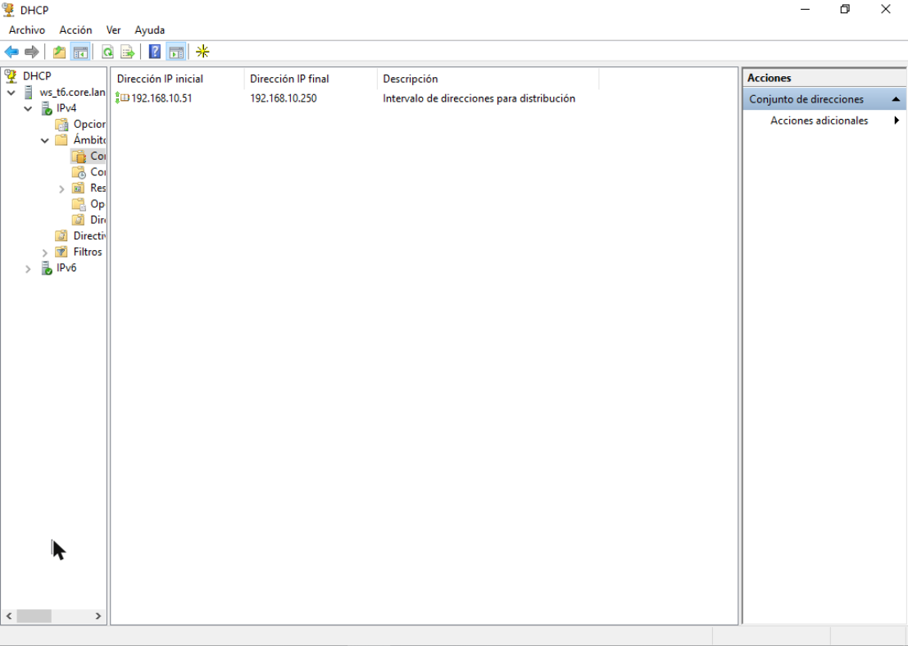

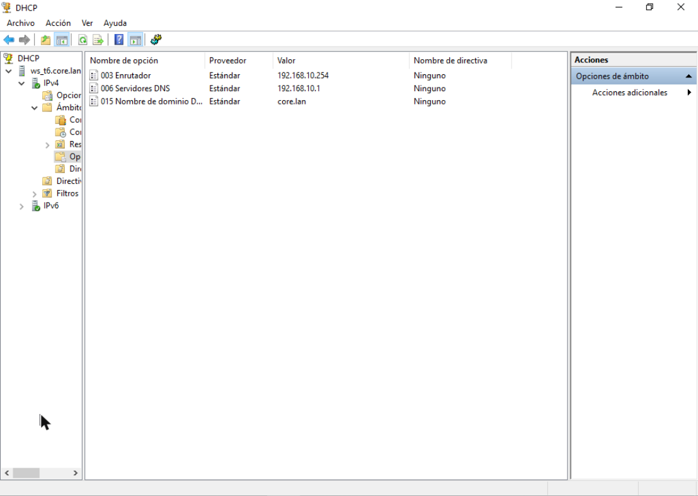

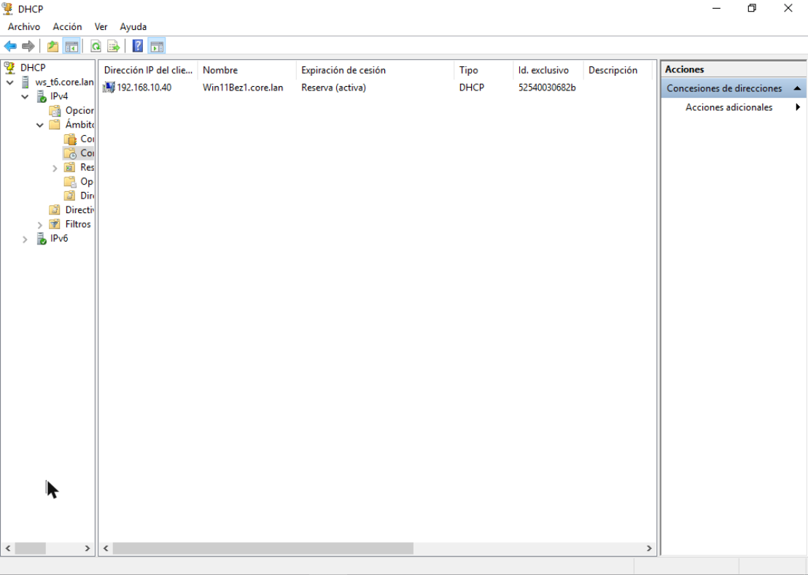

## 2. DNS

DNSan core.lan zona dago, eta 192.168.10 sarearen alderantzizko zona.

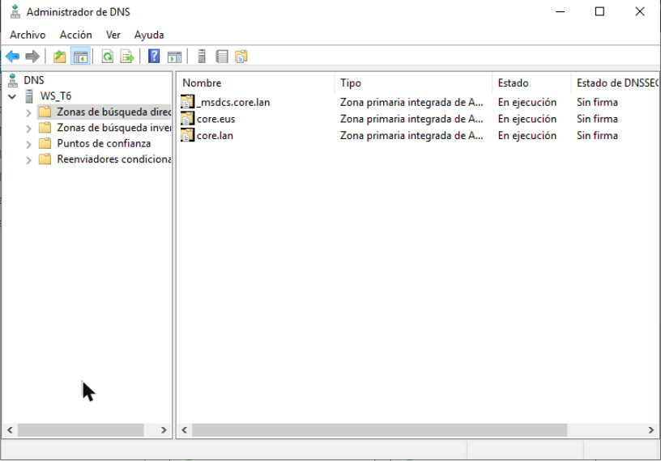

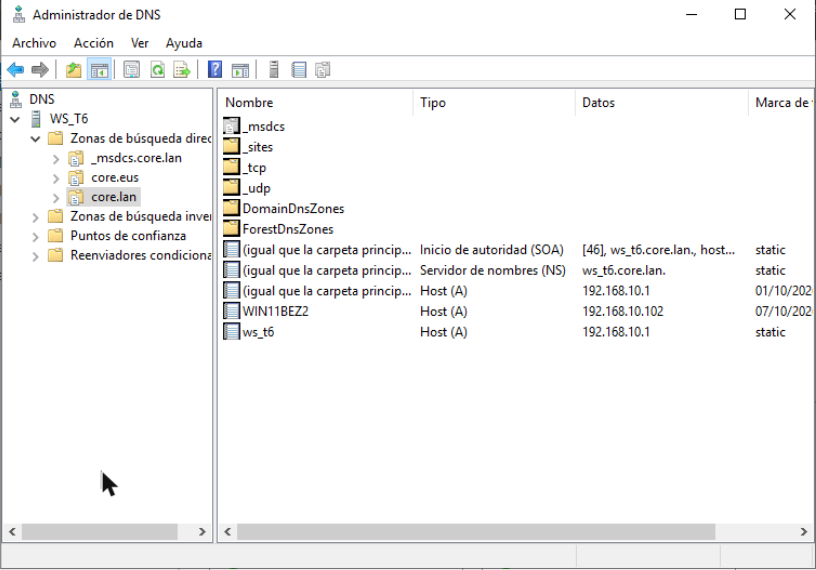

## 3. Audio eta bideo zerbitzua: Jitsi Meet

### 3.1 Zerbitzuaren aukeraketa eta kokapena

Audio eta bideo zerbitzurako Jitsi Meet instalatu dugu. Bideo-deiak egiteko software librea da, nabigatzailetik erabiltzen da eta bezeroetan ez da ezer instalatu behar. Zerbitzu berak ematen ditu audioa eta bideoa, WebRTC bidez.

Zerbitzari propio batean jarri dugu, ez domeinu-kontrolatzailean, zerbitzu bakoitza bere makinan egon dadin eta Jitsiren kargak ez diezaion Active Directoryri eragin.

| Datua | Balioa |
|---|---|
| Makina | JitsiErronka |
| Sistema eragilea | Ubuntu Server 24.04.5 LTS |
| Izena | jitsi.core.eus |
| IPa | 192.168.10.3/24 (finkoa) |
| Sarbidea | https://jitsi.core.eus |

IP finkoa du, bezeroek beti helbide berean aurkitu behar dutelako. 192.168.10.3 helbidea DHCP esparrutik kanpo dago (esparrua 192.168.10.51 helbidean hasten da), beraz DHCPak ezin dio beste ekipo bati eman.

### 3.2 Instalatutako paketeak eta zerbitzuak

Jitsi Meet hainbat osagaik osatzen dute, eta bakoitza zerbitzu bat da:

| Zerbitzua | Paketea eta bertsioa | Zertarako |
|---|---|---|
| nginx | nginx 1.24.0 | Web zerbitzaria. Jitsiren web orria ematen du HTTPS bidez. |
| prosody | prosody 0.12.4 | XMPP zerbitzaria. Bileretako seinaleztapena eta txata. |
| jicofo | jicofo 1.0-1205 | Bilerak kudeatzen ditu: nor sartzen den eta nork zer bidaltzen duen. |
| jitsi-videobridge2 | jitsi-videobridge2 2.3-318 | Audio eta bideo fluxuak parte-hartzaileen artean banatzen ditu (SFU). |
| coturn | coturn 4.6.1 | TURN/STUN zerbitzaria, konexio zuzenik ezin denerako. |

Pakete nagusia jitsi-meet 2.0.11248 da. Bost zerbitzuak martxan daude:

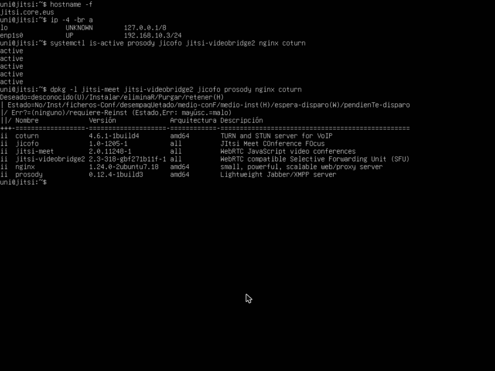

### 3.3 DNS erregistroak

Web orrietarako core.eus zona sortu dugu WS_T6 zerbitzariko DNSan, core.lan domeinutik bereizita. Zona horretan jitsi izeneko A erregistroa dago, 192.168.10.3 helbidera.

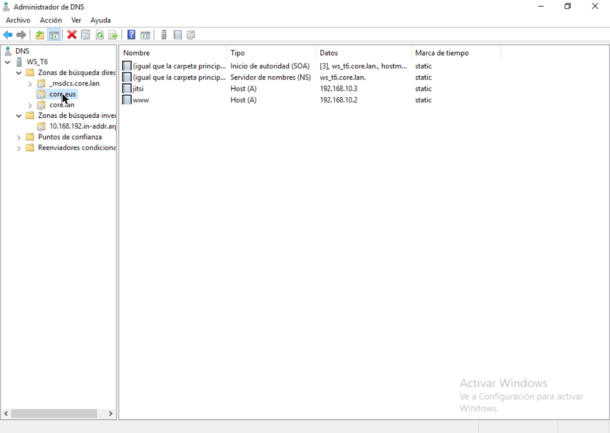

Alderantzizko zonan (10.168.192.in-addr.arpa) dagokion PTR erregistroa dago, 192.168.10.3 helbidetik jitsi.core.eus izenera.

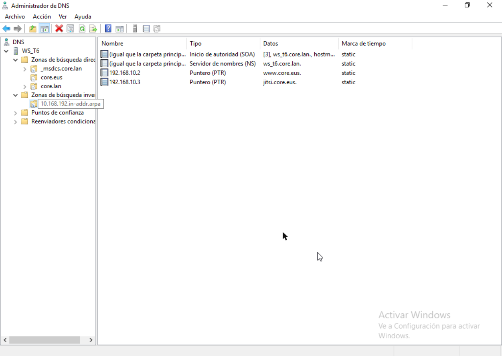

| Zona | Erregistroa | Mota | Balioa |
|---|---|---|---|
| core.eus | jitsi | A | 192.168.10.3 |
| core.eus | www | A | 192.168.10.2 |
| 10.168.192.in-addr.arpa | 192.168.10.3 | PTR | jitsi.core.eus |
| 10.168.192.in-addr.arpa | 192.168.10.2 | PTR | www.core.eus |

Bezeroek DNS gisa WS_T6 dutenez, jitsi.core.eus izena idatzita iristen dira zerbitzarira.

### 3.4 Portuak

Zerbitzarian entzuten dauden portuak hauek dira:

| Portua | Protokoloa | Zerbitzua | Erabilera |
|---|---|---|---|
| 80 | TCP | nginx | HTTP |
| 443 | TCP | nginx | HTTPS. Bezeroak hemendik sartzen dira web orrira. |
| 10000 | UDP | jitsi-videobridge2 | Audio eta bideo fluxuak (RTP) |
| 3478, 3479 | UDP | coturn | STUN/TURN |
| 5349, 5350 | TCP | coturn | TURN TLS gainean |
| 5222, 5269 | TCP | prosody | XMPP |
| 5280, 5281 | TCP | prosody | XMPP HTTP gainean (BOSH) |
| 22 | TCP | sshd | Urruneko administrazioa |

### 3.5 Audioa

Audioa nabigatzaileak hartzen du bezeroaren mikrofonotik eta jitsi-videobridge2 zerbitzuak banatzen du bilerako gainerako kideei. Lehen aldiz sartzean nabigatzaileak baimena eskatzen du mikrofonoa erabiltzeko; onartu ondoren, helbide-barran mikrofonoaren ikonoa agertzen da.

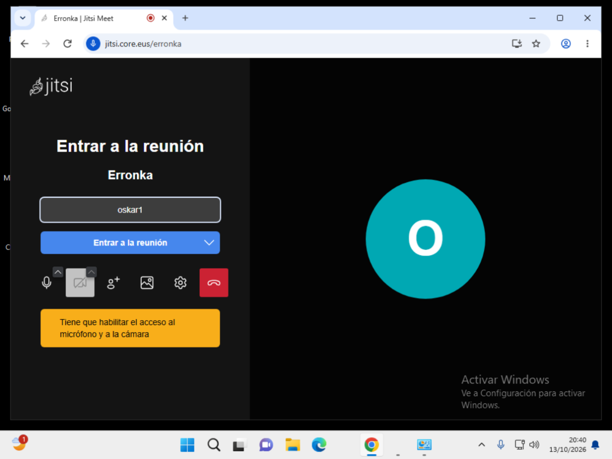

### 3.6 Bideoa

Bideoa ere jitsi-videobridge2 zerbitzuak banatzen du. Bezero bakoitzak bere irudia zerbitzarira bidaltzen du eta zerbitzariak besteei birbidaltzen die, berriro kodetu gabe.

Bezeroak makina birtualak dira eta ez dute kamerarik, horregatik bileran parte-hartzailearen izenaren hizkia agertzen da irudiaren ordez.

### 3.7 Egiaztapena: bi erabiltzaile bilera berean

Domeinuko bi bezerotatik sartu gara bilera berera, https://jitsi.core.eus/erronka helbidean:

| Bezeroa | Nabigatzailea | Bilerako izena |
|---|---|---|
| W11 Oskar1 | Google Chrome | oskar1 |
| W11 Oskar2 | Microsoft Edge | oskar2 |

Bakoitzak bestea ikusten du bileran. W11 Oskar1 bezeroan oskar2 agertzen da erdian:

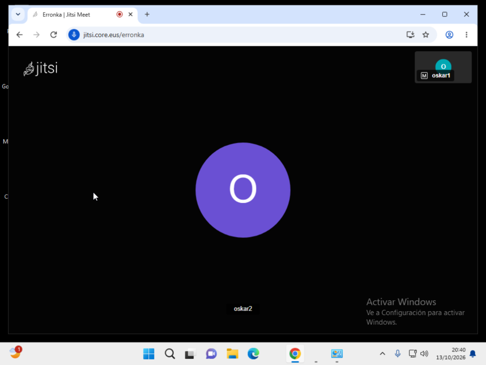

Eta W11 Oskar2 bezeroan oskar1 agertzen da:

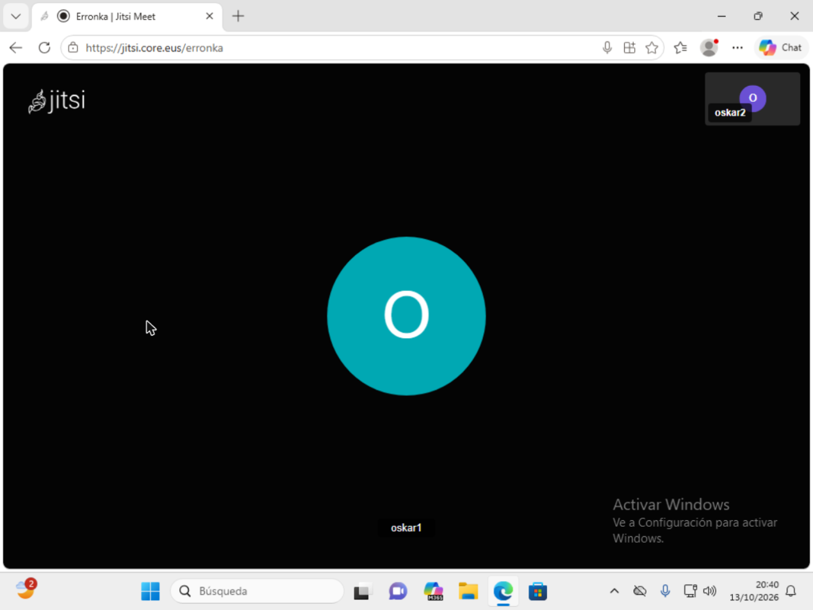
