# 1. Erronka: WAE dokumentazioa

T6 taldea. Web aplikazioen ezarpena.

## 1. GLPI

GLPI enpresaren ekipoak eta intzidentziak kudeatzeko aplikazioa da. Hemen azaltzen dugu nola instalatu dugun eta zer erregistratu dugun.
### 1.1 Instalazioa

GLPI Ubuntu Server makina birtual batean instalatu dugu, Proxmox-en barruan (100 makina). Nabigatzailetik http://192.168.71.186 helbidean sartzen gara.

Instalazioan erabili ditugun parametroak hauek dira:

| Parametroa | Balioa |
|---|---|
| GLPI bertsioa | 10.0.18 |
| Instalazio modua | Tarball (deskargatutako paketea) |
| Karpeta | /var/www/glpi |
| Sistema eragilea | Ubuntu 24.04 |
| Web zerbitzaria | Apache 2.4.58, 80 portua |
| PHP | 8.3.6 |
| Datu-basea | MariaDB 10.11.14 |
| Datu-basearen izena | glpidb |
| Datu-baseko erabiltzailea | admin, localhost-etik |
| Hizkuntza | Gaztelania (es_ES) |

Datu-basea makina berean dago, GLPIk bakarrik erabiltzen duelako eta horrela ez delako sarean irekita egon behar. Datu-baseko erabiltzaileak localhost-etik bakarrik konekta daiteke.

### 1.2 Erregistratutako ekipoak

Enpresako ekipo guztiak GLPIn erregistratu ditugu. Kokapenak, motak eta egoerak euskaraz sortu ditugu, enpresan euskaraz lan egiten dugulako.

Kokapenak: Cloud, Zerbitzari-gela, Finantzak bulegoa, Giza Baliabideak bulegoa, Erosketak bulegoa eta IT bulegoa. Cloud kokapena IsardVDI-n dauden makinentzat da.

#### 1.2.1 Ordenagailuak

| Izena | Mota | Kokapena | Oharrak |
|---|---|---|---|
| WSCore | Zerbitzaria | Cloud | Windows Server, domeinu-kontrolatzailea |
| proxmox | Zerbitzaria | Zerbitzari-gela | Proxmox VE 8.4.0, 192.168.71.185 |
| GLPI | Makina birtuala | Zerbitzari-gela | Ubuntu Server, 192.168.71.186 |
| GLPIBackup | Makina birtuala | Zerbitzari-gela | GLPIren bigarren makina |
| WIN11BEZ1 | Mahaigaineko ordenagailua | Cloud | Windows 11 Pro, 192.168.10.40 |
| WIN11BEZ2 | Mahaigaineko ordenagailua | Cloud | Windows 11 Pro, 192.168.10.102 |

Ordenagailu bakoitzaren Iruzkinak eremuan ezaugarri nagusiak eta IPa idatzi ditugu.

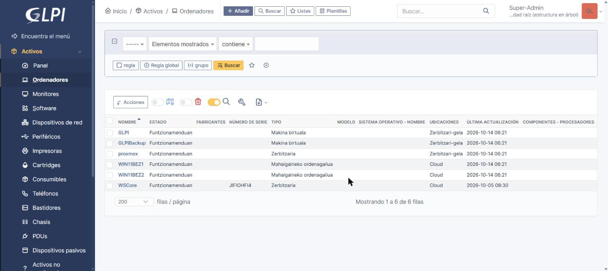

#### 1.2.2 Sareko gailuak

Bi suebaki ditugu eta biak Sareko gailuetan erregistratu ditugu, Suebakia motarekin. pfSense Proxmox-eko 103 makina da. PFSENSE (Cloud) IsardVDI-n dagoena da eta core.lan sarearen atebidea da (192.168.10.254).

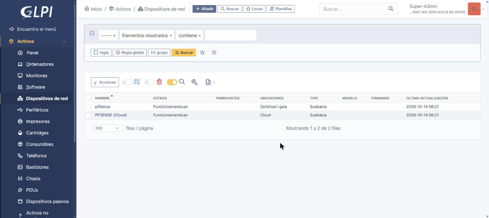

#### 1.2.3 Inprimagailuak

WS_T6 zerbitzarian partekatuta dauden bi inprimagailuak erregistratu ditugu, bakoitza bere saileko bulegoan.

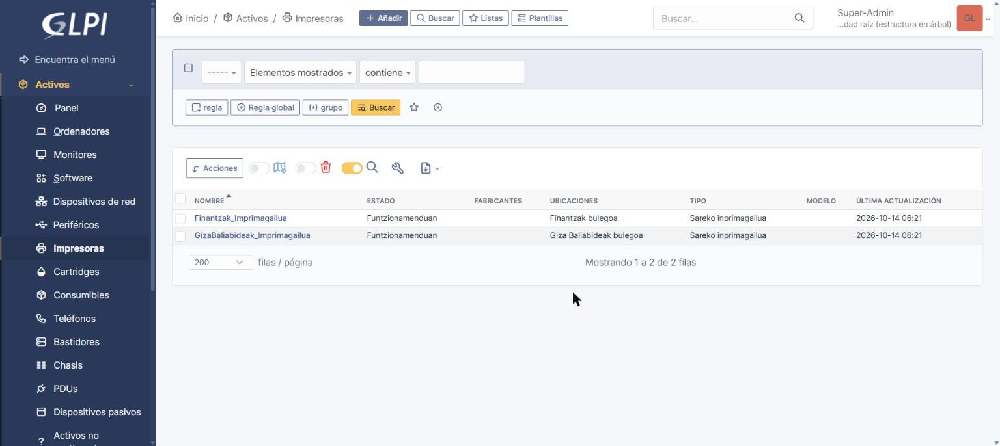

### 1.3 Lizentziak

Windows Server 2025 Standard softwarea sortu dugu, Microsoft editorearekin, eta bi lizentzia gehitu dizkiogu:

| Lizentzia | Mota | Kopurua | Esleituta |
|---|---|---|---|
| Windows Server 2025 Standard (16 nukleo) | Nukleo-lizentzia | 1 | WSCore |
| Windows Server 2025 erabiltzaile CAL | Erabiltzaile CAL | 10 | Erabiltzaileei |

Zerbitzariaren lizentzia WSCore ordenagailuari esleitu diogu. CALak ez dira ordenagailu bati esleitzen, erabiltzaile bakoitzeko direlako. Lizentzien kopurua aurrekostuan erosi ditugunekin bat dator.

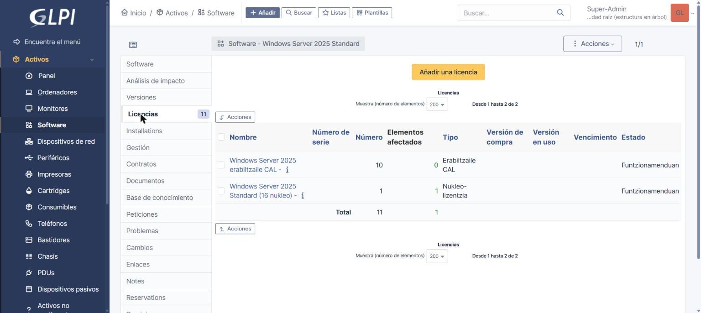

### 1.4 Erabiltzaileak

GLPIk dakartzan erabiltzaileez gain (glpi, tech, normal eta post-only), enpresako sei erabiltzaile sortu ditugu, domeinuan dituzten izen berarekin. Hiru profil desberdin erabili ditugu, bakoitzak GLPIn egin behar duenaren arabera:

| Erabiltzailea | Izena | Profila |
|---|---|---|
| obravo | Oier Bravo | Technician |
| pmalatsetxebarria | Peru Malatsetxebarria | Technician |
| lgarcia | Lierni Garcia | Technician |
| ubarrero | Urtzi Barrero | Supervisor |
| jlopez | Joseba Lopez | Self-Service |
| ltellabide | Luis Tellabide | Self-Service |

IT saileko langileek Technician profila dute, tiketak konpondu eta ekipoak kudeatu behar dituztelako. Urtzik Supervisor profila du, IT saileko arduraduna delako eta taldearen tiketak ikusi eta esleitu behar dituelako. Beste sailetako langileek Self-Service profila dute: tiketak ireki eta beren tiketen egoera ikusi besterik ez dute egin behar.

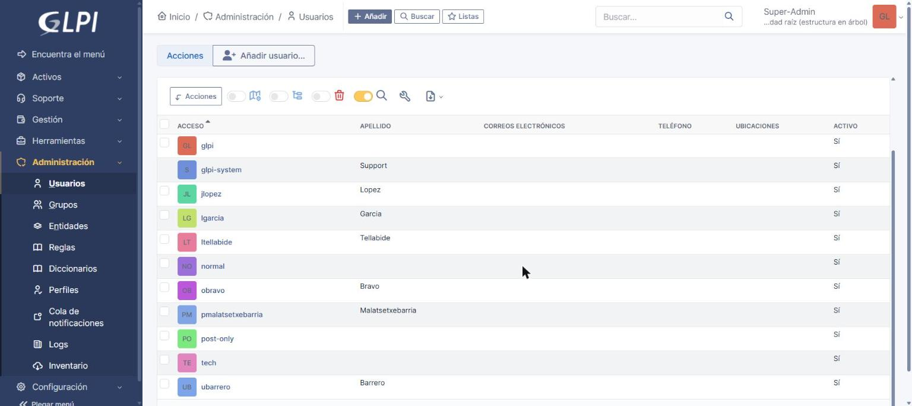

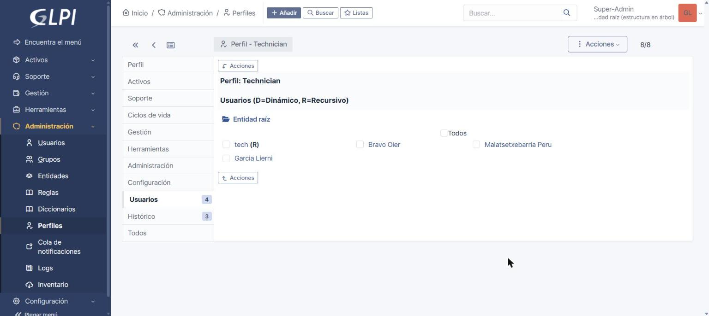

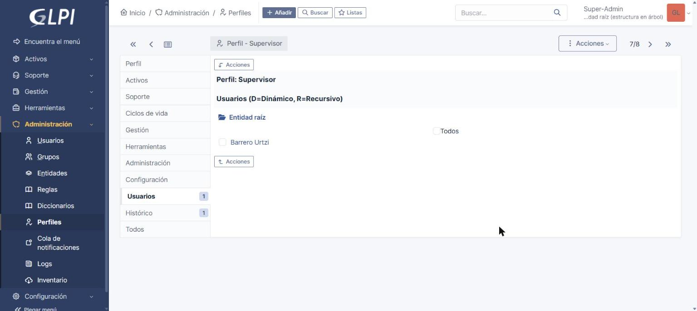

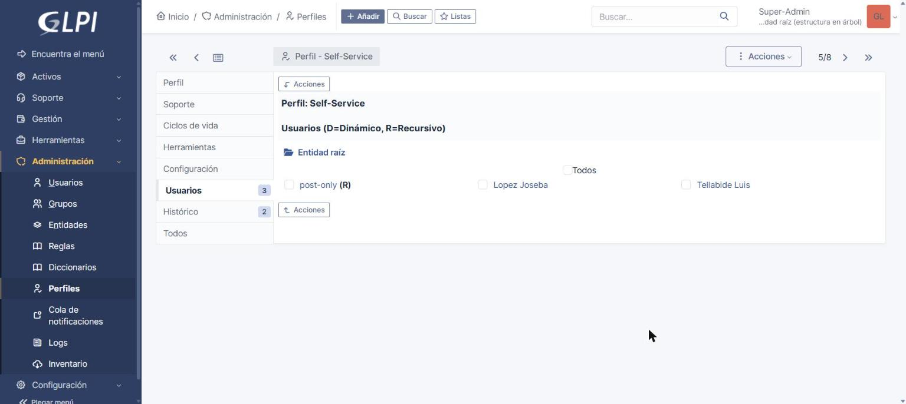

### 1.5 Tiketak

GLPI ondo dabilela egiaztatzeko hiru tiket sortu ditugu. post-only erabiltzaileak eskatzen ditu, langile batek bezala, eta tech erabiltzaileari esleitzen zaizkio, teknikariari bezala.

| ID | Izenburua | Mota | Lotutako elementua |
|---|---|---|---|
| 1 | Finantzak inprimagailuak ez du inprimatzen | Intzidentzia | Finantzak_Imprimagailua |
| 2 | P: unitatea ez da agertzen WIN11BEZ2 ordenagailuan | Intzidentzia | WIN11BEZ2 |
| 3 | Erabiltzaile berria Erosketak sailean | Eskaera | |

Tiketak ekipoekin lotu ditugu, horrela ekipo bakoitzaren fitxan bere arazoen historia ikusten delako.

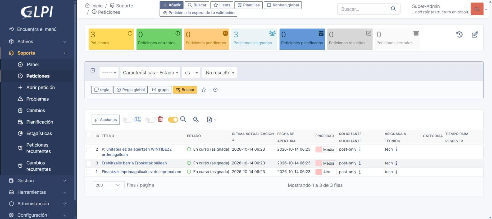

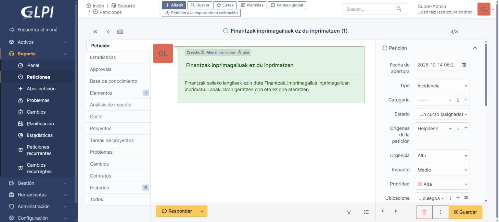

## 2. WordPress

### 2.1 Webgunearen erabilera

WordPress Core enpresaren web orria da. Core inguruko ekoizleen produktu ekologikoak saltzen dituen supermerkatua da, eta webguneak ekoizleak, produktuak eta bezeroen eskaerak erakusten ditu. Helbidea http://www.core.eus da.

WordPress aukeratu dugu webgunea panel batetik kudeatzen delako, programatu gabe, eta eduki mota propioak sor daitezkeelako. Erabilera bakoitzari eduki mota bat dagokio:

| Eduki mota | Zertarako |
|---|---|
| Ekoizleak | Produktuak ematen dizkiguten baserri eta kooperatibak, eta dendatik duten distantzia |
| Produktuak | Salgai dauden produktuak |
| Eskaerak | Bezeroek egindako eskaerak |
| Inkesta erantzunak | Bezeroen iritzi-inkestaren erantzunak |
| Dokumentuak | Enpresaren dokumentuak |

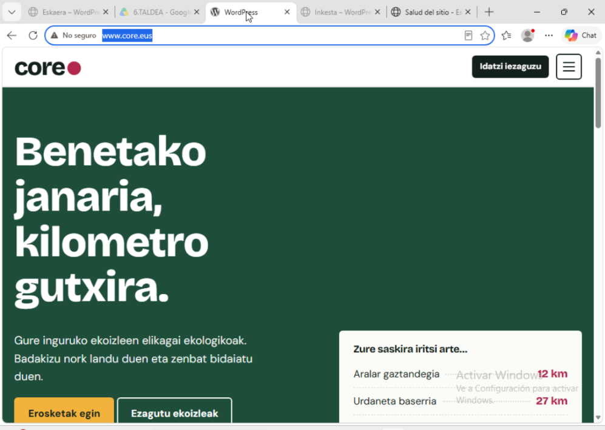

### 2.2 Instalazioa

| Parametroa | Balioa |
|---|---|
| Zerbitzaria | Ubuntu Server (USWordpress makina, servidor ostalari-izena) |
| IPa | 192.168.10.2 |
| Helbidea | http://www.core.eus |
| Karpeta | /srv/www/wordpress |
| WordPress bertsioa | 7.1.3 |
| PHP | 7.4.3 |
| Datu-basea | wordpress, localhost-en |
| Datu-baseko erabiltzailea | wordpress |
| Karaktere-jokoa | utf8mb4 |

WordPress lehenengo aldiz IP helbidetik instalatu genuen, eta horregatik www.core.eus izenarekin sartzean IPra birbideratzen zuen. Konpontzeko, wp-config.php fitxategian WP_HOME eta WP_SITEURL konstanteak gehitu ditugu http://www.core.eus balioarekin. DNSan core.eus zonako www erregistroak 192.168.10.2 helbidera eramaten du (ikusi SZI dokumentazioa).

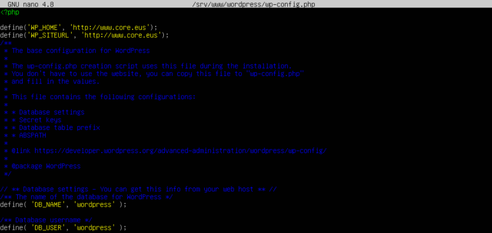

### 2.3 Erabiltzaileak

Webgunearen erabiltzaileak domeinuko langileak dira, izen berarekin. Bakoitzari bere lanerako behar duen baimen minimoa eman diogu, eta horregatik bost rol desberdin daude:

| Erabiltzailea | Izena | Saila | Rola | Zer egin dezake |
|---|---|---|---|---|
| Admin | Admin | | Administratzailea | Instalazioan sortutako kontua. Larrialdietarako bakarrik |
| barrero.urtzi | Urtzi Barrero | IT (arduraduna) | Administratzailea | Dena: gaiak, pluginak, ezarpenak eta erabiltzaileak |
| obravo | Oier Bravo | IT | Editorea | Eduki guztia argitaratu eta editatu, besteena ere, eta iruzkinak moderatu |
| iherran | Iker Herran | Erosketak | Egilea | Bere edukia argitaratu eta irudiak igo: ekoizle eta produktu berriak |
| jgalarza | Jon Galarza | Erosketak | Laguntzailea | Zirriborroak idatzi; editore batek berrikusi behar ditu argitaratu aurretik |
| ltellabide | Luis Tellabide | Giza Baliabideak | Harpideduna | Edukia irakurri eta bere profila aldatu |

Urtzi IT saileko arduraduna denez, administratzailea da eta webgunearen konfigurazioa kudeatzen du. Oierrek edukia berrikusi eta argitaratzen du. Erosketak sailean Ikerrek produktu eta ekoizle berriak argitaratzen ditu, eta Jonek zirriborroak bakarrik idazten ditu, beraz bere lana beti berrikusten da. Luisek ez du edukia aldatu behar. Horrela inork ez du behar duena baino baimen gehiago, eta pasahitz bat lapurtuz gero kaltea txikiagoa da.
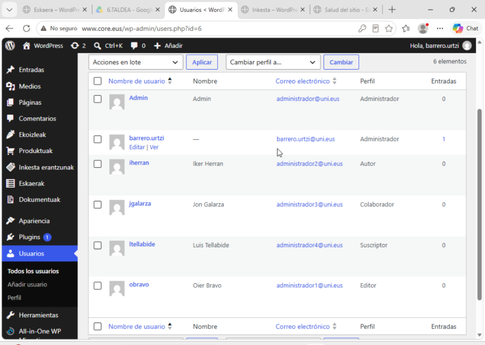

### 2.4 Gaiak

Zazpi gai instalatu eta probatu ditugu, tartean General Food Store, Twenty Twenty-Five, Twenty Twenty-Four eta Twenty Twenty-Three. General Food Store elikagai-dendetarako gaia da, gure enpresaren antzekoa. Azkenean Core izeneko gai propioa aktibatu dugu, enpresaren koloreekin eta diseinuarekin.

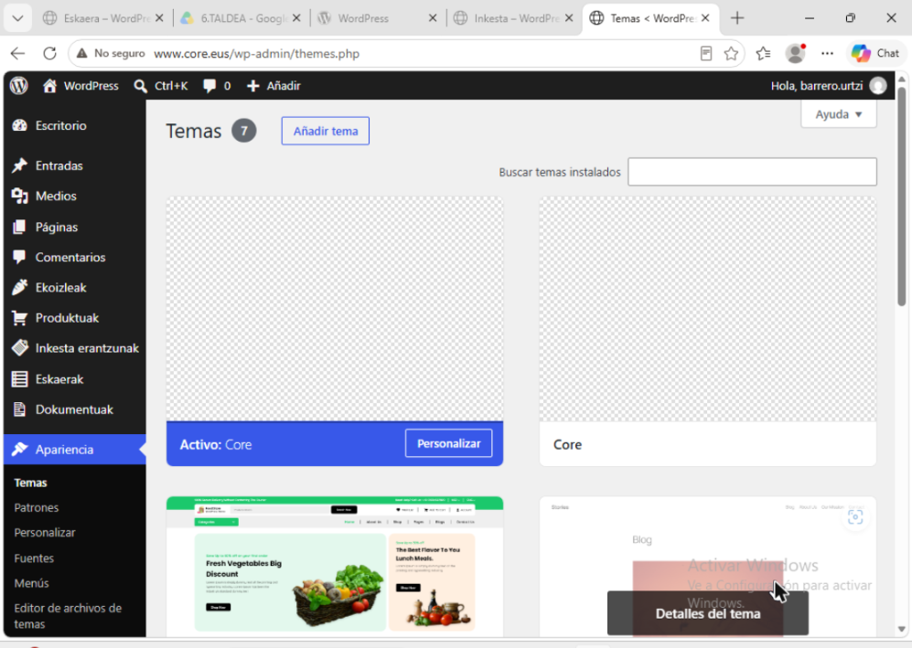

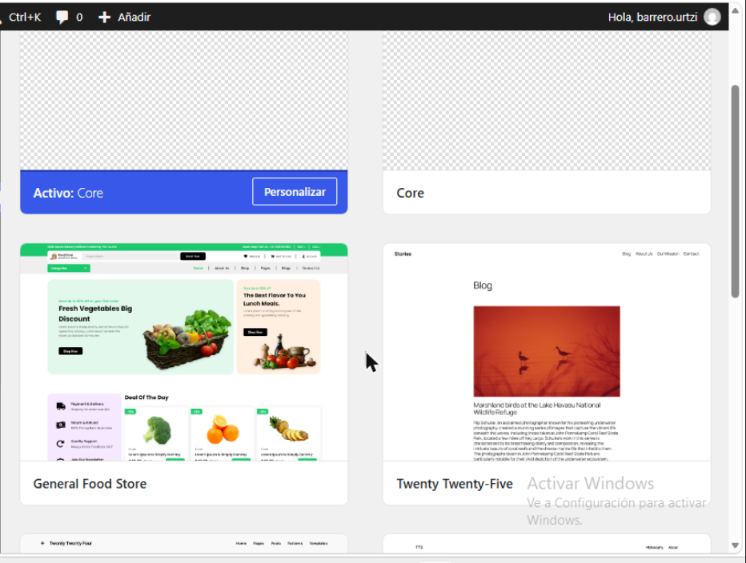
## 3. GitHub biltegia eta GitHub Pages

### 3.1 Biltegia

Erronkaren dokumentazio guztia GitHub-eko biltegi batean dago: https://github.com/barrerourtzi-dotcom/Erronka1_T6

Biltegi bakarra erabiltzen dugu taldekide guztiok, dokumentazio guztia leku batean egon dadin eta edozeinek aldaketen historia ikus dezan.

Modulu bakoitzak bere adarra du: SEA, SZI eta Hardware. Modulu bakoitzeko lana bere adarrean egiten dugu eta, bukatuta dagoenean, main adarrera batzen dugu. Horrela taldekide batek bere moduluan lan egin dezake besteen lana hautsi gabe, eta main adarrean zuzendutako bertsioa bakarrik dago.

### 3.2 Biltegiaren egitura

```
Erronka1_T6/
├── README.md                                  Hasierako orria eta aurkibidea
├── _config.yml                                GitHub Pages-en konfigurazioa
├── Dokumentazioa_SEA.md                       Sistema eragileen administrazioa
├── Dokumentazioa_SB.md                        Sistema banatuak (Proxmox)
├── Dokumentazioa_WAE.md                       Web aplikazioak (GLPI, WordPress, GitHub eta plangintza)
├── Datu_Base_eta_Segurtasun_Estrategia.md     Datu-baseak eta segurtasuna
├── Dokumentazioa_HW.md                        Hardwarea: aurrekostua, osagaiak eta tailerra
├── Dokumentazioa_SZI.md                       Sareko zerbitzuak
├── Jasangarritasun_Plana-Core.md              Jasangarritasun plana
├── index.md                                   Webgunearen hasierako orria
├── _layouts/ eta assets/                      Webgunearen diseinua
├── _data/nav.yml                              Alboko barraren menua
└── Irudiak/                                   Dokumentuetako kaptura guztiak
```

Modulu bakoitzak bere .md fitxategia du, eta kaptura guztiak Irudiak karpetan daude. Irudien izenak modulu bakoitzaren aurrizkiarekin hasten dira (sb-, glpi-, wae-, sea-), horrela karpetan erraz bereizten direlako.

Dokumentu guztiek egitura bera dute: izenburua, atal zenbakituak, taulak datuentzat eta kaptura bakoitza dagokion azalpenaren ondoan.

### 3.3 GitHub Pages

Biltegia GitHub Pages bidez argitaratu dugu, dokumentazioa web orri gisa irakurtzeko GitHub-en kontua izan gabe: https://barrerourtzi-dotcom.github.io/Erronka1_T6/

Settings, Pages atalean main adarra eta erro karpeta aukeratu ditugu. GitHub-ek .md fitxategiak HTML orri bihurtzen ditu Jekyll-ekin. Diseinu propioa egin dugu: _layouts/default.html txantiloiak alboko barra bat jartzen du orri guztietan, eta assets/css/erronka.css fitxategiak itxura ematen dio. Alboko barrako menua _data/nav.yml fitxategian dago; dokumentu berri bat gehitzeko nahikoa da hor sarrera bat gehitzea.

index.md fitxategia webgunearen hasierako orria da, ikasgai bakoitzeko txartel batekin. README.md fitxategiak aurkibide bera erakusten du GitHub-en bertan. Alboko barran uneko dokumentuaren atalak ere agertzen dira, eta hortik edozein ataletara heltzen da klik batekin.

## 4. Plangintza

T6 taldea. Erronkaren zereginak moduluka eta bakoitzaren egoera.

### 4.1 Zereginak

#### SEA: Sistema eragileen administrazioa

| Zeregina | Egoera |
|---|---|
| core.lan domeinua eta Active Directory instalatu | Eginda |
| DNS eta DHCP konfiguratu | Eginda |
| OUak, erabiltzaileak eta taldeak sortu | Eginda |
| Bezeroak domeinuan sartu | Eginda |
| GPOak sortu eta estekatu | Eginda |
| Inprimagailuak Windows Server-en partekatu | Eginda |
| Inprimagailuen baimenak saileko taldeei eman | Egiteke |
| Zerbitzuak eta prozesuak kudeatu (IE2) | Egiten |
| Bezeroaren ebidentziak (IP, GPOak, unitateak) | Eginda |
| Inprimaketa Linuxen CUPSekin eta sistemen artean | Egiten |

#### SB: Sistema banatuak

| Zeregina | Egoera |
|---|---|
| Proxmox instalatu eta sareak sortu | Eginda |
| GLPI eta GLPIBackup makina birtualak sortu | Eginda |
| pfSense makina birtuala sortu | Eginda |
| CT102 edukiontzia sortu | Eginda |
| Erabilgarritasun handiko soluzioa proposatu | Eginda |
| GLPI pfSense-ren atzean jarri | Egiten |

#### WAE: Web aplikazioen ezarpena

| Zeregina | Egoera |
|---|---|
| GLPI instalatu | Eginda |
| Ekipoak, lizentziak eta tiketak erregistratu | Eginda |
| GLPI erabiltzaileak profilekin sortu | Eginda |
| GitHub biltegia eta adarrak sortu | Eginda |
| GitHub Pages argitaratu | Eginda |
| WordPress instalatu eta www.core.eus helbidean jarri | Eginda |
| WordPress erabiltzaileak rol desberdinekin | Eginda |

#### Hardwarea

| Zeregina | Egoera |
|---|---|
| Hardware eta lizentzien aurrekostua | Eginda |
| Osagaien dokumentazioa | Eginda |

### 4.2 Erronkan zehar egindako aldaketak

| Aldaketa | Zergatia |
|---|---|
| Aurrekostuan zerbitzari bakoitzarentzat ekipo fisiko bat jarri dugu, makina birtualak erabili beharrean | Erronkak zerbitzari bakoitza ekipo fisiko batean egotea eskatzen du |
| Aurrekostuan 2 bezero izatetik 10 izatera pasa gara | Domeinuan 10 erabiltzaile daude eta bakoitzak bere ordenagailua behar du |
| CT102 edukiontzia zerbitzurik gabe utzi dugu | Irakasleak esan digu nahikoa dela edukiontzia sortzea |
| GLPI pfSense-ren barneko sarera eramatea erabaki dugu | GLPI zuzenean ikastetxeko sarean zegoen, suebakirik gabe |
| WordPress-en helbidea IPtik www.core.eus izenera aldatu dugu wp-config.php fitxategian | IPtik instalatu zenez, izenarekin sartzean IPra birbideratzen zuen |
